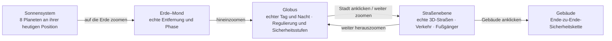
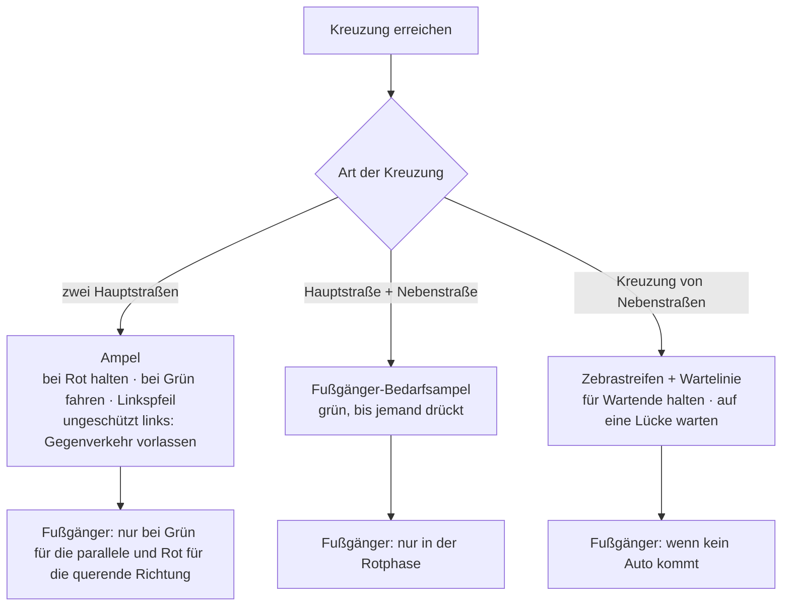
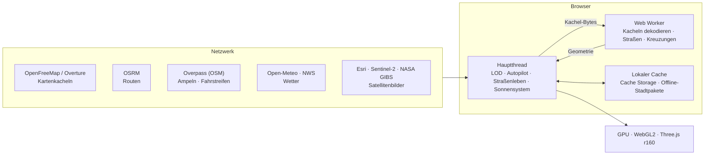

# Sicherheitsglobus · Sentinel Earth (Deutsch)

[中文](README.zh.md) · [English](README.en.md) · [中英对照](README.zh-en.md) · [한국어](README.ko.md) · **Deutsch** · [日本語](README.ja.md) · [Русский](README.ru.md) · [Español](README.es.md) · [Übersicht](README.md)

Ein Projekt für den Kurs CSE635 Software Security Engineering: eine direkt deploybare 3D-Globus-Website. Vom ganzen Sonnensystem lässt sich bis zur Erde, einer Stadt, ihren Straßen und einem einzelnen Gebäude zoomen; jede Ebene zeigt das passende Wissen zur Sicherheitsarchitektur.

---

## 1. Die Zoomstufen im Überblick



## 2. Schnellstart

| Weg | Schritte |
|---|---|
| Windows, lokal | `start-sentinel-earth.bat` doppelklicken; der Browser öffnet http://localhost:8000 |
| Jedes System, lokal | Im Projektordner `python srv.py 8000` ausführen und http://localhost:8000 öffnen |
| Deployment | Der Ordner ist die Website selbst, ohne Build-Schritt. Dieses GitHub-Repository in Vercel importieren oder den Ordner auf app.netlify.com/drop ziehen |

> Der lokale Server `srv.py` schaltet den Browser-Cache ab, ein Neuladen zeigt also immer den neuesten Code.

### Auf dem eigenen Computer starten (Schritt für Schritt)

**Schritt 1 · Vorbereiten**
- Browser: ein aktueller Chrome, Edge, Firefox oder Safari mit WebGL2-Unterstützung und eingeschalteter Hardwarebeschleunigung.
- Python 3.8 oder neuer: unter Windows von python.org installieren und „Add python.exe to PATH“ anhaken; macOS und Linux bringen meist `python3` mit.
- Etwa 1 GB freier Speicher (das Projekt selbst ist mit den Offline-Stadtpaketen etwa 420 MB groß). Mit eigener Grafikkarte läuft es flüssiger.

**Schritt 2 · Code holen** (eine der beiden Arten)
- Im Browser herunterladen: https://github.com/tianmingliu-pixel/sentinel-earth öffnen, auf die grüne Schaltfläche „Code“ → „Download ZIP“ klicken und in einen beliebigen Ordner entpacken.
- Mit Git: `git clone --depth 1 https://github.com/tianmingliu-pixel/sentinel-earth.git`

**Schritt 3 · Starten**
- Windows: den entpackten Ordner öffnen und `start-sentinel-earth.bat` doppelklicken. Ein schwarzes Fenster erscheint, und der Browser öffnet sich von selbst.
- macOS / Linux: im Terminal `cd sentinel-earth` und `python3 srv.py 8000` ausführen, dann http://localhost:8000 im Browser öffnen.
- Das Serverfenster während der Nutzung offen lassen; Schließen oder Strg+C beendet den Server.

**Fehlerbehebung**

| Problem | Lösung |
|---|---|
| Doppelklick auf `index.html` funktioniert nicht | Browser verbieten Seiten, lokale Datendateien direkt zu lesen; die Seite wie in Schritt 3 über den lokalen Server öffnen |
| Port 8000 ist belegt | Einen anderen Port nehmen, z. B. `python srv.py 8080`, dann http://localhost:8080 öffnen |
| Leere Seite oder sehr langsam | Hardwarebeschleunigung in den Browsereinstellungen einschalten; unten auf der Seite die „Qualität“ senken |
| Andere erreichen meinen Computer nicht | `srv.py` nimmt nur Verbindungen von diesem Computer an; zum Teilen die Website auf Vercel oder Netlify bereitstellen |
| Auf die neueste Version aktualisieren | Mit Git `git pull` ausführen; beim ZIP erneut herunterladen |

> Netzwerk: Die 3D-Engine liegt im Ordner `lib/` des Projekts, die Seite öffnet sich also auch ohne Internet; der Globus und Städte mit Offline-Paket funktionieren normal. Live-Straßen, Routen, Wetter und Satellitenbilder brauchen Internet.

---

## 3. Funktionen

### 3.1 Globus
- Ziehen zum Drehen, Scrollen zum Zoomen. Ein Klick auf ein Land zeigt seine Sicherheitsstufe (SL1 öffentlich → SL5 kritisch) und seinen Regulierungsrahmen.
- Eine Zeitleiste mit 238 verifizierten Sicherheitsvorfällen (1971 bis heute), filterbar nach Quellenebene oder nach Vorfällen, die eine Organisation gemeldet hat.
- „Hinfliegen“ listet standardmäßig je Land oder Region eine Hauptstadt (225), nach Kontinenten gruppiert; das Suchfeld durchsucht alle 2.353 Orte.
- Der Abdeckungs-Scan bewertet jede Stadt nach der Gebäudedichte im Zentrum mit A–D; der Bericht lässt sich als CSV oder JSON exportieren.

### 3.2 Sonnensystem
- „Sonnensystem“ auf dem Globus einschalten: Die Sonne steht in ihrer echten Richtung, die Tag-Nacht-Grenze der Erde entspricht also diesem Moment; der Mond steht in echter Entfernung und Phase; Merkur bis Neptun erscheinen in ihrer echten Richtung am Himmel.
- Weiter herauszoomen zeigt erst das Erde-Mond-System, dann die Sonnensystem-Ansicht mit allen acht Planeten an ihrer heutigen Position auf ihren Bahnen. Ein Klick auf einen Planeten zeigt Radius, Abstand zur Sonne und zur Erde, Lichtlaufzeit sowie Umlauf- und Rotationsdauer.
- Zeitleiste unten: live, Pause, 1 Tag/s, 1 Woche/s, 1 Monat/s, 1 Jahr/s.
- Die Positionen stammen aus Schlyters Ephemeride niedriger Genauigkeit (etwa 1–2′). Abstände und Größen in der Sonnensystem-Ansicht sind gestaucht, nicht maßstäblich.

### 3.3 Straßenebene
- Live-Straßen aus OpenStreetMap, die beim Bewegen nachladen; Blöcke mit wenigen Gebäuden werden aus Overture Maps ergänzt.
- Gebäude sind nach Nutzungsart eingefärbt (Wohnen, Gewerbe, Behörde, Krankenhaus, Bildung …). Ein Klick zeigt die Ende-zu-Ende-Sicherheitskette vom Nutzer bis zum Backend.
- Echte Sonne, echter Mond, Wolken, Nebel, Regen, Schnee und Gewitter, Straßenbäume nach Jahreszeit, Straßenlaternen und beleuchtete Fenster bei Nacht.
- Himmelsauge: Satellitenbilder, MGRS/UTM-Koordinaten, mehrere Sensormodi, Vorfälle in der Nähe, überfliegende Satelliten, Erdbeben und Naturereignisse.

### 3.4 Autopilot und Verkehrsregeln



- Nach Wahl eines Ziels folgt das Auto einer echten OSRM-Route (kein Teleportieren). Cockpit-, Verfolger- und Drohnenbegleit-Kamera.
- Die Fahrstreifenzahl kommt aus dem OpenStreetMap-Tag `lanes`, sonst gilt ein Standard nach Straßenklasse; Einbahn- und Zweirichtungsstraßen werden getrennt behandelt. Autos fahren mittig im Fahrstreifen.
- Vor dem Linksabbiegen ordnet sich das Auto zur Mittellinie ein und wartet an der Haltelinie; Rechtsabbieger nutzen den äußeren Fahrstreifen; am Ziel hält es am Fahrbahnrand.
- Autos, Fußgänger, Hunde und Katzen in der Umgebung folgen denselben Regeln. Fußgänger gehen nur auf Gehwegen und Überwegen.
- Nur in OpenStreetMap tatsächlich eingetragene STOP-Schilder bleiben erhalten.

### 3.5 Sprache: 中文 / EN / 双语
- Drei Schaltflächen oben rechts; der zweisprachige Modus zeigt beides nebeneinander, z. B. „限速 / LIMIT“. Die Wahl bleibt im Browser gespeichert.
- Alle Oberflächentexte liegen im Sprachpaket `i18n.js` (siehe Abschnitt 5).

---

## 4. Architektur



- Alles wird im Browser berechnet; es gibt kein eigenes Backend und keine eigene Datenbank.
- Das Netzwerk dient nur zum Abrufen von Daten (Kacheln, Routen, Wetter, Bilder), und abgerufene Daten werden im Browser zwischengespeichert.
- Der Worker dekodiert Kacheln und baut die Straßengeometrie, der Hauptthread übernimmt Interaktion und Simulation, die GPU zeichnet nur.

---

## 5. Dateien

```
sentinel-earth/
├─ index.html              Seitenstruktur und Stile
├─ app.js                  gesamte Anwendungslogik (Globus, Straßen, Fahren, Straßenleben, Sonnensystem …)
├─ i18n.js                 Sprachpaket: Chinesisch / Englisch / zweisprachig
├─ data.js                 Lehrdaten: Sicherheitsstufen, Gebäudetypen, Regulierung
├─ data/
│  ├─ cities.json          2.353 Orte (225 Hauptstädte)
│  ├─ events.json          238 Sicherheitsvorfälle
│  ├─ nodes.json           Netzwerkknoten auf dem Globus
│  ├─ earth/               Erdtexturen und Ländervektoren
│  ├─ streets/             Straßenkerne der Städte
│  └─ bundles/             Offline-Stadtpakete (144 Dateien, etwa 416 MB)
├─ lib/three.min.js       3D-Engine Three.js r160 (lokale Kopie)
├─ LICENSE                 MIT-Lizenz und Hinweise zu Daten Dritter
├─ srv.py                  lokaler Server (ohne Cache)
├─ start-sentinel-earth.bat  Start mit einem Klick unter Windows
├─ vercel.json             Deployment-Konfiguration
└─ README*.md              Dokumentation
```

### Das Sprachpaket `i18n.js` verwenden

| Teil | Inhalt |
|---|---|
| `ui` | Oberflächenbeschriftungen: Titel, Panels, Legenden |
| `s` | alle übrigen Bildschirmtexte (474): HUDs, Panels, Hinweise, Fahren, Himmelsauge, Straßenleben, Sonnensystem |
| `pick()` | die gemeinsame Auswahlregel aller drei Modi |

Jeder Eintrag ist Schlüssel → [Chinesisch, Englisch]. Einen Text hinzufügen:
1. In `i18n.js` unter `s` eine Zeile ergänzen, z. B. `my_label:['我的标签','My label'],`
2. In `app.js` mit `I18T('my_label')` anzeigen.
3. Alle drei Sprachmodi übernehmen ihn automatisch.

---

## 6. Datenquellen

© OpenStreetMap-Mitwirkende · OpenMapTiles · OpenFreeMap (Straßenkacheln) · Overture Maps Foundation (Gebäudeergänzung) · OSRM (Routen) · Overpass API (Ampeln, Fahrstreifen) · NASA GIBS / EONET · USGS · CelesTrak · RainViewer · Esri Wayback · Open-Meteo (Wetter, CC BY 4.0) · NASA (Erdbilder) · Schlyters Verfahren für Planetenpositionen (Sonnensystem).

## 7. Hinweise

- Die umweltbezogene Sicherheitslage und die Netzwerkketten der Gebäude sind Lehrreferenzen, keine Bewertung bestimmter Gebäude oder Organisationen.
- Wo eine Hauptstadt umstritten ist (etwa Israel, Palästina), zeigt die Liste die Stadt, in der die Regierungsinstitutionen tatsächlich sitzen.
- Lizenz: Der Code steht unter der MIT-Lizenz (siehe `LICENSE`). Straßen- und Ortsdaten aus OpenStreetMap stehen unter der ODbL 1.0; bei Weiterverwendung muss die Namensnennung erhalten bleiben.
