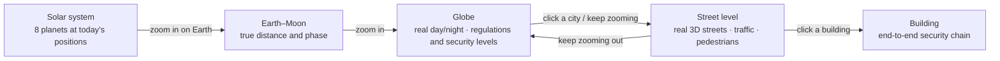
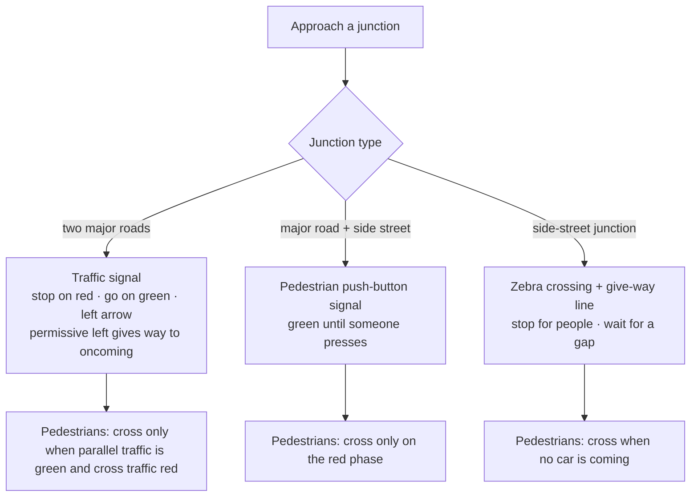
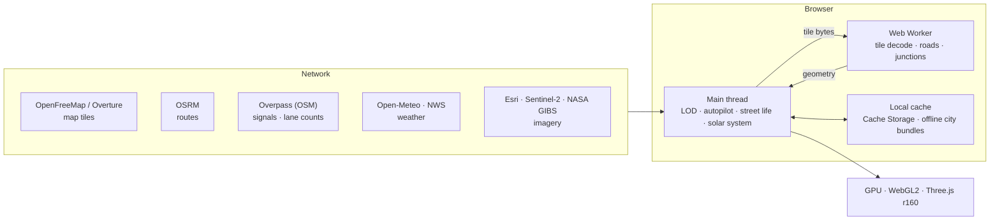

# Sentinel Earth · 安全地球 (English)

[中文](README.zh.md) · **English** · [中英对照](README.zh-en.md) · [한국어](README.ko.md) · [Deutsch](README.de.md) · [日本語](README.ja.md) · [Русский](README.ru.md) · [Español](README.es.md) · [Overview](README.md)

A CSE635 Software Security Engineering project: a deployable 3D globe website. Zoom from the whole solar system down to Earth, a city, its streets and a single building; every level shows the matching security-architecture knowledge.

---

## 1. Zoom levels at a glance



## 2. Quick start

| How | Steps |
|---|---|
| Windows, local | Double-click `start-sentinel-earth.bat`; the browser opens http://localhost:8000 |
| Any OS, local | Run `python srv.py 8000` in the project folder, then open http://localhost:8000 |
| Deploy | The folder is the site itself; there is no build step. Import this GitHub repository in Vercel, or drag the folder onto app.netlify.com/drop |

> The local server `srv.py` turns off browser caching, so a refresh always shows the latest code.

---

## 3. Features

### 3.1 Globe
- Drag to rotate, scroll to zoom. Click any country for its security level (SL1 Public → SL5 Critical) and regulatory frame.
- A timeline of 238 verified security events (1971 to today), filterable by source tier or by events an organisation reported.
- "Fly to" lists one capital per country or region by default (225), grouped by continent; the search box covers all 2,353 places.
- Coverage scan grades each city A–D by building density at its centre; the report exports as CSV or JSON.

### 3.2 Solar system
- Turn on "Solar system" on the globe: the Sun sits in its true direction, so Earth's day/night line matches this moment; the Moon is at its true distance and phase; Mercury to Neptune appear in their true directions in the sky.
- Keep zooming out to see the Earth–Moon system, then the solar-system view with all eight planets at today's positions on their orbits. Click a planet for its radius, distance from the Sun and from Earth, light time, and orbital and rotation periods.
- Time bar at the bottom: live, pause, 1 day/s, 1 week/s, 1 month/s, 1 year/s.
- Positions come from Schlyter's low-precision ephemeris (about 1–2′). Distances and sizes in the solar-system view are compressed, not to scale.

### 3.3 Street level
- Live OpenStreetMap streets that stream in as you move; blocks with few buildings are filled from Overture Maps.
- Buildings are coloured by planning type (residential, commercial, government, hospital, education…). Click one for its end-to-end security chain from user to back end.
- Real sun, moon, clouds, fog, rain, snow and storms, seasonal street trees, street lamps and lit windows at night.
- Sky eye: satellite imagery, MGRS/UTM coordinates, several sensor modes, nearby events, passing satellites, earthquakes and natural hazards.

### 3.4 Autopilot and traffic rules



- Set a destination and the car follows a real OSRM route (no teleporting). Cockpit, chase and drone-escort cameras.
- Lane counts come from the OpenStreetMap `lanes` tag, with class defaults where it is missing; one-way and two-way roads are handled separately. Cars stay centred in a lane.
- Before a left turn the car moves to the lane by the centre line and waits at the stop line; right turns use the outside lane; at the destination it pulls over to the kerb.
- Ambient cars, pedestrians, dogs and cats follow the same rules. Pedestrians walk only on pavements and crossings.
- Only STOP signs actually mapped in OpenStreetMap are kept.

### 3.5 Language: 中文 / EN / 双语
- Three buttons at the top right; bilingual mode shows both side by side, e.g. "限速 / LIMIT". The choice is remembered in the browser.
- All interface text lives in the language pack `i18n.js` (see section 5).

---

## 4. Architecture



- Everything is computed in the browser; there is no back end or database of its own.
- The network is only used to fetch data (tiles, routes, weather, imagery), and fetched data is cached in the browser.
- The worker decodes tiles and builds road geometry, the main thread handles interaction and simulation, and the GPU only draws.

---

## 5. Files

```
sentinel-earth/
├─ index.html              page structure and styles
├─ app.js                  all application logic (globe, streets, driving, street life, solar system…)
├─ i18n.js                 language pack: Chinese / English / bilingual
├─ data.js                 teaching data: security levels, building types, regulations
├─ data/
│  ├─ cities.json          2,353 places (225 capitals)
│  ├─ events.json          238 security events
│  ├─ nodes.json           network nodes on the globe
│  ├─ earth/               Earth textures and country vectors
│  ├─ streets/             street cores of each city
│  └─ bundles/             offline city bundles (144 files, about 416 MB)
├─ srv.py                  local server (no cache)
├─ start-sentinel-earth.bat  one-click start on Windows
├─ vercel.json             deployment config
└─ README*.md              documentation
```

### Using the language pack `i18n.js`

| Part | Contents |
|---|---|
| `ui` | interface labels: title, panels, legends |
| `s` | every other on-screen string (474): HUDs, panels, toasts, driving, sky eye, street life, solar system |
| `pick()` | the one rule all three modes use |

Each entry is key → [Chinese, English]. To add a string:
1. Add a line to `s` in `i18n.js`, e.g. `my_label:['我的标签','My label'],`
2. Show it in `app.js` with `I18T('my_label')`.
3. All three language modes pick it up automatically.

---

## 6. Data sources

© OpenStreetMap contributors · OpenMapTiles · OpenFreeMap (street tiles) · Overture Maps Foundation (building fill) · OSRM (routes) · Overpass API (signals, lane counts) · NASA GIBS / EONET · USGS · CelesTrak · RainViewer · Esri Wayback · Open-Meteo (weather, CC BY 4.0) · NASA (Earth imagery) · Schlyter's planetary-position method (solar system).

## 7. Notes

- The environmental security posture and building network chains are teaching references, not assessments of any specific building or organisation.
- Where a capital is disputed (for example Israel, Palestine), the list shows the city where the government institutions actually sit.
