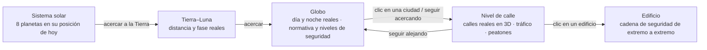
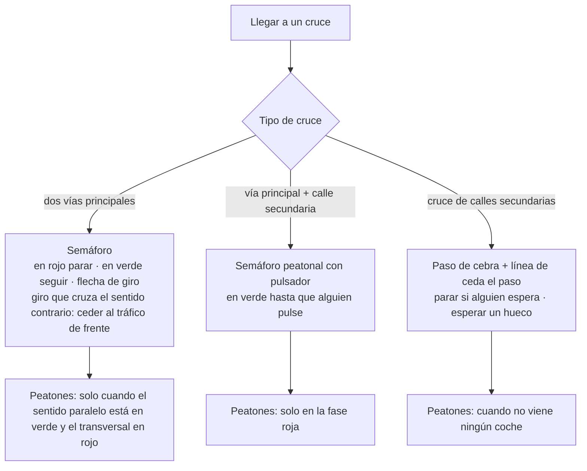
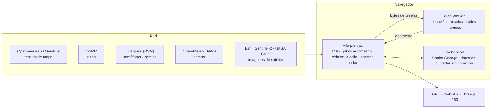

# Tierra Segura · Sentinel Earth (español)

[中文](README.zh.md) · [English](README.en.md) · [中英对照](README.zh-en.md) · [한국어](README.ko.md) · [Deutsch](README.de.md) · [日本語](README.ja.md) · [Русский](README.ru.md) · **Español** · [Resumen](README.md)

Proyecto del curso CSE635 de Ingeniería de Seguridad del Software: un sitio web con un globo en 3D listo para publicar. Se puede acercar desde todo el sistema solar hasta la Tierra, una ciudad, sus calles y un solo edificio; cada nivel muestra el conocimiento de arquitectura de seguridad que le corresponde.

---

## 1. Los niveles de zoom de un vistazo



## 2. Inicio rápido

| Forma | Pasos |
|---|---|
| Windows, en local | Doble clic en `start-sentinel-earth.bat`; el navegador abre http://localhost:8000 |
| Cualquier sistema, en local | Ejecute `python srv.py 8000` en la carpeta del proyecto y abra http://localhost:8000 |
| Publicación | La carpeta es el sitio en sí; no hay paso de compilación. Importe este repositorio de GitHub en Vercel o arrastre la carpeta a app.netlify.com/drop |

> El servidor local `srv.py` desactiva la caché del navegador, así que al recargar siempre se ve el código más reciente.

---

## 3. Funciones

### 3.1 Globo
- Arrastre para girar y use la rueda para acercar o alejar. Al hacer clic en un país se ve su nivel de seguridad (de SL1 Público a SL5 Crítico) y su marco normativo.
- Una línea de tiempo con 238 incidentes de seguridad verificados (de 1971 a hoy), filtrable por nivel de fuente o por incidentes que comunicó una organización.
- «Volar a» muestra por defecto una capital por país o región (225), agrupadas por continente; el buscador abarca los 2353 lugares.
- El análisis de cobertura califica cada ciudad de A a D según la densidad de edificios en su centro; el informe se exporta en CSV o JSON.

### 3.2 Sistema solar
- Active «Sistema solar» en el globo: el Sol está en su dirección real, así que la línea entre el día y la noche en la Tierra coincide con este momento; la Luna está a su distancia real y en su fase real; de Mercurio a Neptuno aparecen en su dirección real en el cielo.
- Si sigue alejando, primero se ve el sistema Tierra–Luna y luego la vista del sistema solar, con los ocho planetas en su posición de hoy sobre sus órbitas. Al hacer clic en un planeta se ven su radio, la distancia al Sol y a la Tierra, el tiempo que tarda la luz, y sus periodos orbital y de rotación.
- Barra de tiempo abajo: en vivo, pausa, 1 día/s, 1 semana/s, 1 mes/s, 1 año/s.
- Las posiciones se calculan con las efemérides de baja precisión de Schlyter (unos 1–2′). Las distancias y los tamaños en la vista del sistema solar están comprimidos; no están a escala.

### 3.3 Nivel de calle
- Calles de OpenStreetMap que se cargan a medida que se avanza; las manzanas con pocos edificios se completan con datos de Overture Maps.
- Los edificios se colorean según su uso (residencial, comercial, gubernamental, hospital, educación…). Al hacer clic en uno se ve su cadena de seguridad de extremo a extremo, del usuario al servidor.
- Sol y Luna reales, nubes, niebla, lluvia, nieve y tormentas, árboles de calle según la estación, farolas y ventanas encendidas por la noche.
- Ojo del cielo: imágenes de satélite, coordenadas MGRS/UTM, varios modos de sensor, incidentes cercanos, satélites que pasan, terremotos y desastres naturales.

### 3.4 Piloto automático y normas de tráfico



- Tras elegir un destino, el coche sigue una ruta real de OSRM (sin teletransportarse). Cámaras de cabina, de persecución y de dron escolta.
- El número de carriles viene de la etiqueta `lanes` de OpenStreetMap y, si falta, de un valor por defecto según el tipo de vía; las vías de un sentido y de doble sentido se tratan por separado. Los coches circulan por el centro del carril.
- Antes de un giro que cruza el sentido contrario (a la izquierda cuando se circula por la derecha), el coche se coloca en el carril junto a la línea central y espera en la línea de detención; el giro opuesto usa el carril exterior; al llegar al destino se detiene junto a la acera.
- Los coches, peatones, perros y gatos del entorno siguen las mismas normas. Los peatones solo caminan por aceras y pasos de peatones.
- Solo se conservan las señales de STOP que figuran de verdad en OpenStreetMap.

### 3.5 Idioma: 中文 / EN / 双语
- Tres botones arriba a la derecha; el modo bilingüe muestra ambos idiomas uno junto al otro, por ejemplo «限速 / LIMIT». La elección queda guardada en el navegador.
- Todos los textos de la interfaz están en el paquete de idioma `i18n.js` (véase la sección 5).

---

## 4. Arquitectura



- Todo se calcula en el navegador; no hay servidor ni base de datos propios.
- La red solo se usa para obtener datos (teselas, rutas, tiempo, imágenes), y los datos obtenidos se guardan en la caché del navegador.
- El worker decodifica las teselas y construye la geometría de las calles, el hilo principal se ocupa de la interacción y la simulación, y la GPU solo dibuja.

---

## 5. Archivos

```
sentinel-earth/
├─ index.html              estructura y estilos de la página
├─ app.js                  toda la lógica de la aplicación (globo, calles, conducción, vida en la calle, sistema solar…)
├─ i18n.js                 paquete de idioma: chino / inglés / bilingüe
├─ data.js                 datos didácticos: niveles de seguridad, tipos de edificio, normativa
├─ data/
│  ├─ cities.json          2353 lugares (225 capitales)
│  ├─ events.json          238 incidentes de seguridad
│  ├─ nodes.json           nodos de red en el globo
│  ├─ earth/               texturas de la Tierra y vectores de fronteras
│  ├─ streets/             núcleos de calles de cada ciudad
│  └─ bundles/             datos de ciudades sin conexión (144 archivos, unos 416 MB)
├─ srv.py                  servidor local (sin caché)
├─ start-sentinel-earth.bat  arranque con un clic en Windows
├─ vercel.json             configuración de publicación
└─ README*.md              documentación
```

### Cómo usar el paquete de idioma `i18n.js`

| Parte | Contenido |
|---|---|
| `ui` | etiquetas de la interfaz: título, paneles, leyendas |
| `s` | todos los demás textos de la pantalla (474): HUD, paneles, avisos, conducción, ojo del cielo, vida en la calle, sistema solar |
| `pick()` | la regla común de selección de los tres modos |

Cada entrada es clave → [chino, inglés]. Para añadir un texto:
1. Añada una línea en `s` dentro de `i18n.js`, por ejemplo `my_label:['我的标签','My label'],`
2. Muéstrela en `app.js` con `I18T('my_label')`.
3. Los tres modos de idioma la recogen automáticamente.

---

## 6. Fuentes de datos

© colaboradores de OpenStreetMap · OpenMapTiles · OpenFreeMap (teselas de calles) · Overture Maps Foundation (complemento de edificios) · OSRM (rutas) · Overpass API (semáforos, carriles) · NASA GIBS / EONET · USGS · CelesTrak · RainViewer · Esri Wayback · Open-Meteo (tiempo, CC BY 4.0) · NASA (imágenes de la Tierra) · método de Schlyter para la posición de los planetas (sistema solar).

## 7. Notas

- La situación de seguridad según el entorno y las cadenas de red de los edificios son material didáctico de referencia, no una evaluación de ningún edificio u organización concretos.
- Donde la capital está en disputa (por ejemplo, Israel, Palestina), la lista muestra la ciudad donde se encuentran realmente las instituciones del gobierno.
