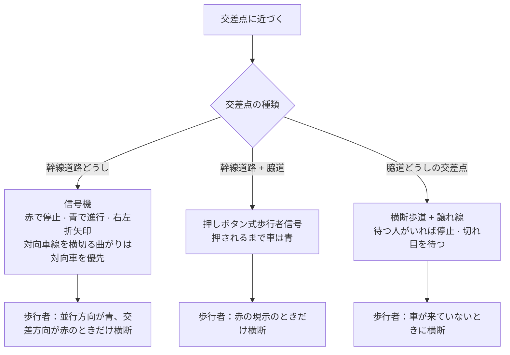
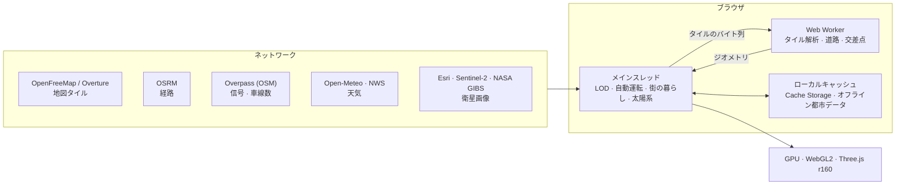

# 安全地球 · Sentinel Earth（日本語）

[中文](README.zh.md) · [English](README.en.md) · [中英对照](README.zh-en.md) · [한국어](README.ko.md) · [Deutsch](README.de.md) · **日本語** · [Русский](README.ru.md) · [Español](README.es.md) · [概要](README.md)

CSE635 ソフトウェアセキュリティ工学の課題として作った、そのままデプロイできる 3D 地球儀サイトです。太陽系全体から地球、都市、街路、一棟の建物まで拡大でき、それぞれの階層で対応するセキュリティアーキテクチャの知識を見られます。

---

## 1. 拡大レベルの全体像


## 2. クイックスタート

| 方法 | 手順 |
|---|---|
| Windows（ローカル） | `start-sentinel-earth.bat` をダブルクリックすると、ブラウザが http://localhost:8000 を開きます |
| 任意の OS（ローカル） | プロジェクトフォルダで `python srv.py 8000` を実行し、http://localhost:8000 を開きます |
| デプロイ | このフォルダがそのままサイトで、ビルド手順はありません。Vercel でこの GitHub リポジトリを取り込むか、フォルダを app.netlify.com/drop にドラッグします |

> ローカルサーバー `srv.py` はブラウザのキャッシュを無効にするので、再読み込みすれば常に最新のコードが表示されます。

---

## 3. 機能

### 3.1 地球儀
- ドラッグで回転、スクロールで拡大縮小。国をクリックすると、セキュリティレベル（SL1 公開 → SL5 重要）と規制の枠組みが表示されます。
- 検証済みのセキュリティ事件 238 件のタイムライン（1971 年から現在まで）。情報源の階層や、機関が報告した事件だけに絞り込めます。
- 「移動先」リストは、既定では国・地域ごとに首都を一つ（225 か所）大陸別に表示します。検索欄では全 2,353 か所を探せます。
- カバレッジスキャンは、都市中心部の建物密度で A–D を評価し、レポートは CSV または JSON で書き出せます。

### 3.2 太陽系
- 地球儀で「太陽系」をオンにすると、太陽が実際の方向に置かれ、地球の昼夜の境界が今この瞬間と一致します。月は実際の距離と月相で、水星から海王星までは今の空での実際の方向に現れます。
- さらに縮小すると地球–月の系を経て太陽系ビューに入り、8 つの惑星が今日の位置で軌道上に並びます。惑星をクリックすると、半径、太陽と地球からの距離、光の到達時間、公転周期と自転周期が表示されます。
- 下部のタイムバー：リアルタイム、一時停止、1 日/秒、1 週/秒、1 か月/秒、1 年/秒。
- 位置は Schlyter の低精度暦（誤差約 1–2′）で計算しています。太陽系ビューの距離と大きさは圧縮されており、実際の比率ではありません。

### 3.3 ストリートレベル
- OpenStreetMap の街路を移動に合わせて読み込み、建物が少ない区画は Overture Maps のデータで補います。
- 建物は用途（住宅、商業、官公庁、病院、教育など）ごとに色分けされ、クリックするとユーザーからバックエンドまでのエンドツーエンドのセキュリティチェーンが表示されます。
- 実際の太陽と月、雲、霧、雨、雪、雷雨、季節ごとの街路樹、夜の街灯と明かりのついた窓。
- 天眼（衛星）ビュー：衛星画像、MGRS/UTM 座標、複数のセンサーモード、周辺の事件、上空を通過する衛星、地震と自然災害。

### 3.4 自動運転と交通ルール



- 目的地を設定すると、車は OSRM の実際の経路をたどって走ります（瞬間移動はしません）。運転席、追従、ドローン随伴の 3 つのカメラがあります。
- 車線数は OpenStreetMap の `lanes` タグから取り、ない場合は道路の等級ごとの既定値を使います。一方通行と対面通行を区別し、車は車線の中央を走ります。
- 対向車線を横切る曲がり（右側通行では左折）の前は中央線側の車線に移って停止線で待ち、反対方向への曲がりは外側の車線を使い、目的地では路肩に停車します。
- 周りの車、歩行者、犬や猫も同じルールに従います。歩行者は歩道と横断歩道だけを歩きます。
- STOP 標識は、OpenStreetMap に実際に登録されているものだけを残しています。

### 3.5 言語：中文 / EN / 双语
- 右上の 3 つのボタンで切り替えます。二言語モードでは「限速 / LIMIT」のように並べて表示します。選択はブラウザに保存されます。
- 画面のすべての文言は言語パック `i18n.js` にあります（第 5 節を参照）。

---

## 4. アーキテクチャ



- すべての計算はブラウザ内で行い、独自のバックエンドやデータベースはありません。
- ネットワークはデータ（タイル、経路、天気、画像）の取得にだけ使い、取得したデータはブラウザにキャッシュします。
- ワーカーがタイルを解析して道路のジオメトリを作り、メインスレッドが操作とシミュレーションを、GPU は描画だけを担当します。

---

## 5. ファイル構成

```
sentinel-earth/
├─ index.html              ページ構造とスタイル
├─ app.js                  アプリの全ロジック（地球儀、街路、運転、街の暮らし、太陽系…）
├─ i18n.js                 言語パック：中国語 / 英語 / 二言語
├─ data.js                 教材データ：セキュリティレベル、建物の種類、規制
├─ data/
│  ├─ cities.json          2,353 か所（首都 225 か所を含む）
│  ├─ events.json          セキュリティ事件 238 件
│  ├─ nodes.json           地球儀上のネットワークノード
│  ├─ earth/               地球のテクスチャと国境ベクター
│  ├─ streets/             各都市の街路中心部
│  └─ bundles/             オフライン都市データ（144 ファイル、約 416 MB）
├─ srv.py                  ローカルサーバー（キャッシュなし）
├─ start-sentinel-earth.bat  Windows でワンクリック起動
├─ vercel.json             デプロイ設定
└─ README*.md              ドキュメント
```

### 言語パック `i18n.js` の使い方

| 部分 | 内容 |
|---|---|
| `ui` | インターフェースのラベル：タイトル、パネル、凡例 |
| `s` | そのほかすべての画面の文言（474 件）：HUD、パネル、通知、運転、天眼、街の暮らし、太陽系 |
| `pick()` | 3 つのモードが共通で使う選択ルール |

各項目は キー → [中国語, 英語] です。文言を追加するには：
1. `i18n.js` の `s` に 1 行加えます。例：`my_label:['我的标签','My label'],`
2. `app.js` で `I18T('my_label')` を使って表示します。
3. 3 つの言語モードすべてに自動で反映されます。

---

## 6. データの出典

© OpenStreetMap 寄稿者 · OpenMapTiles · OpenFreeMap（街路タイル）· Overture Maps Foundation（建物の補完）· OSRM（経路）· Overpass API（信号、車線数）· NASA GIBS / EONET · USGS · CelesTrak · RainViewer · Esri Wayback · Open-Meteo（天気、CC BY 4.0）· NASA（地球画像）· Schlyter の惑星位置計算法（太陽系）。

## 7. 注意

- 環境面のセキュリティ態勢と建物のネットワークチェーンは教材としての参考情報で、特定の建物や組織を評価するものではありません。
- 首都が係争中の場所（例：イスラエル、パレスチナ）は、政府機関が実際に置かれている都市を表示しています。
