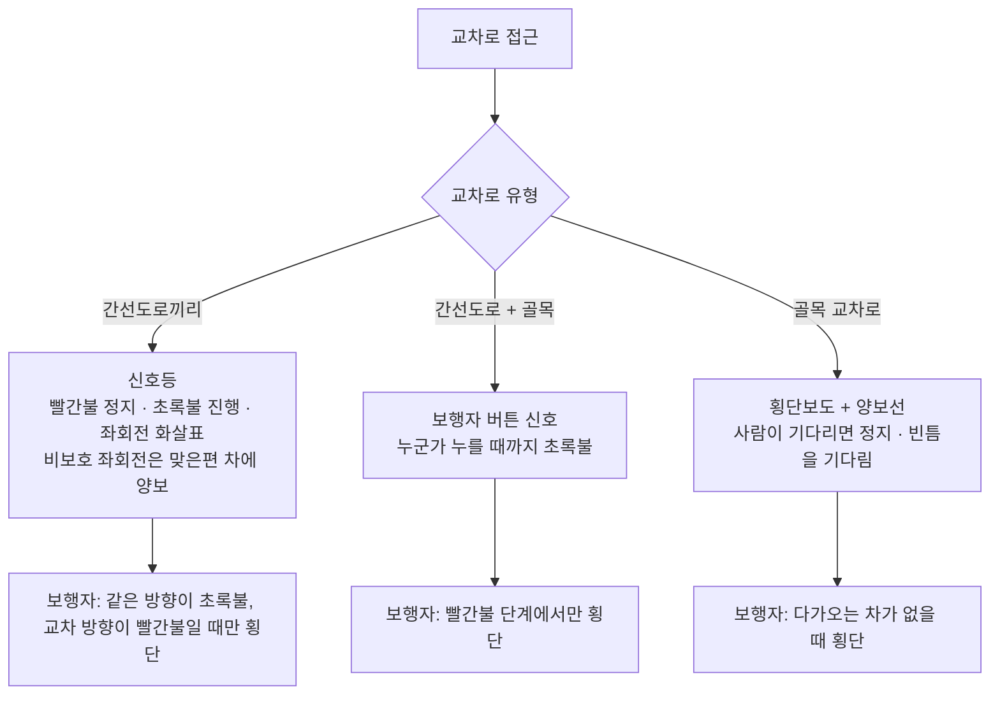
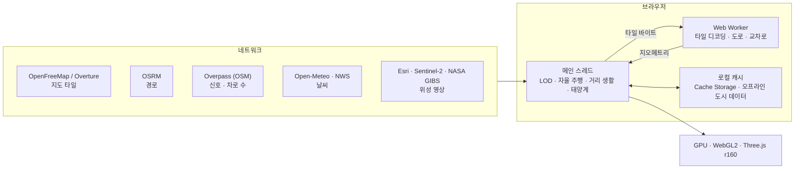

# 안전 지구 · Sentinel Earth (한국어)

[中文](README.zh.md) · [English](README.en.md) · [中英对照](README.zh-en.md) · **한국어** · [Deutsch](README.de.md) · [日本語](README.ja.md) · [Русский](README.ru.md) · [Español](README.es.md) · [개요](README.md)

CSE635 소프트웨어 보안 공학 과목 프로젝트로, 바로 배포할 수 있는 3D 지구본 웹사이트입니다. 태양계 전체에서 지구, 도시, 거리, 건물 한 채까지 확대할 수 있고, 각 단계마다 그에 맞는 보안 아키텍처 지식을 보여 줍니다.

---

## 1. 확대 단계 한눈에 보기


## 2. 빠른 시작

| 방법 | 절차 |
|---|---|
| Windows 로컬 | `start-sentinel-earth.bat`를 더블클릭하면 브라우저가 http://localhost:8000 을 엽니다 |
| 모든 OS 로컬 | 프로젝트 폴더에서 `python srv.py 8000`을 실행하고 http://localhost:8000 을 엽니다 |
| 배포 | 이 폴더가 곧 사이트이며 빌드 단계가 없습니다. Vercel에서 이 GitHub 저장소를 가져오거나, 폴더를 app.netlify.com/drop 에 끌어다 놓습니다 |

> 로컬 서버 `srv.py`는 브라우저 캐시를 끄므로, 새로고침하면 항상 최신 코드가 보입니다.

### 내 컴퓨터에서 실행하기 (단계별)

**1단계 · 준비**
- 브라우저: 최신 Chrome, Edge, Firefox 또는 Safari. WebGL2를 지원하고 하드웨어 가속이 켜져 있어야 합니다.
- Python 3.8 이상: Windows는 python.org에서 설치하고 "Add python.exe to PATH"를 체크합니다. macOS와 Linux에는 보통 `python3`가 들어 있습니다.
- 디스크 공간 약 1 GB(프로젝트 자체는 오프라인 도시 데이터를 포함해 약 420 MB). 외장 그래픽카드가 있으면 더 부드럽습니다.

**2단계 · 코드 받기** (둘 중 하나)
- 브라우저로 내려받기: https://github.com/tianmingliu-pixel/sentinel-earth 에서 초록색 "Code" → "Download ZIP"을 누르고 아무 폴더에나 압축을 풉니다.
- Git 사용: `git clone --depth 1 https://github.com/tianmingliu-pixel/sentinel-earth.git`

**3단계 · 실행**
- Windows: 압축을 푼 폴더에서 `start-sentinel-earth.bat`를 더블클릭합니다. 검은 창이 뜨고 브라우저가 자동으로 열립니다.
- macOS / Linux: 터미널에서 `cd sentinel-earth`와 `python3 srv.py 8000`을 실행한 뒤 브라우저에서 http://localhost:8000 을 엽니다.
- 사용하는 동안 서버 창을 닫지 마세요. 창을 닫거나 Ctrl+C를 누르면 서버가 멈춥니다.

**문제 해결**

| 문제 | 해결 방법 |
|---|---|
| `index.html`을 더블클릭하면 열리지 않음 | 브라우저는 페이지가 로컬 데이터 파일을 직접 읽지 못하게 막습니다. 3단계처럼 로컬 서버로 여세요 |
| 8000번 포트가 이미 사용 중 | 다른 포트를 씁니다. 예: `python srv.py 8080` 후 http://localhost:8080 열기 |
| 화면이 비어 있거나 매우 느림 | 브라우저 설정에서 하드웨어 가속을 켜고, 페이지 아래의 "화질"을 낮춥니다 |
| 다른 사람이 내 컴퓨터에 접속하지 못함 | `srv.py`는 이 컴퓨터의 접속만 받습니다. 공유하려면 Vercel이나 Netlify에 배포하세요 |
| 최신 버전으로 업데이트 | Git은 `git pull`, ZIP은 다시 내려받습니다 |

> 네트워크: 3D 엔진이 프로젝트의 `lib/` 폴더에 들어 있어 인터넷 없이도 사이트가 열리고, 지구본과 오프라인 데이터가 있는 도시는 정상적으로 볼 수 있습니다. 실시간 거리, 경로, 날씨, 위성 영상은 인터넷이 필요합니다.

---

## 3. 기능

### 3.1 지구본
- 드래그로 회전, 스크롤로 확대·축소합니다. 국가를 클릭하면 보안 등급(SL1 공개 → SL5 핵심)과 규제 체계를 볼 수 있습니다.
- 검증된 보안 사건 238건의 타임라인(1971년부터 현재까지). 출처 계층별로 거르거나 기관이 보고한 사건만 볼 수 있습니다.
- "바로 가기" 목록은 기본으로 국가·지역마다 수도 하나(225곳)를 대륙별로 보여 주고, 검색창은 전체 2,353곳을 찾습니다.
- 커버리지 스캔은 도시 중심부의 건물 밀도로 A–D 등급을 매기며, 보고서는 CSV나 JSON으로 내보낼 수 있습니다.

### 3.2 태양계
- 지구본에서 "태양계"를 켜면 태양이 실제 방향에 놓여 지구의 낮밤 경계가 지금과 같아지고, 달은 실제 거리와 위상으로, 수성부터 해왕성까지는 지금 하늘에서의 실제 방향에 나타납니다.
- 계속 축소하면 지구–달 시스템을 거쳐 태양계 시점으로 들어가, 여덟 행성이 오늘의 위치로 궤도 위에 놓입니다. 행성을 클릭하면 반지름, 태양·지구까지의 거리, 빛의 도달 시간, 공전·자전 주기를 볼 수 있습니다.
- 아래쪽 시간 막대: 실시간, 일시정지, 1일/초, 1주/초, 1개월/초, 1년/초.
- 위치는 Schlyter 저정밀 천체력(약 1–2′)으로 계산합니다. 태양계 시점의 거리와 크기는 압축되어 실제 비율이 아닙니다.

### 3.3 거리 레벨
- OpenStreetMap 거리를 이동하면서 실시간으로 불러오고, 건물이 적은 블록은 Overture Maps 데이터로 보완합니다.
- 건물은 계획 용도(주거, 상업, 정부, 병원, 교육 등)별로 색칠되며, 클릭하면 사용자에서 백엔드까지의 엔드투엔드 보안 체인을 보여 줍니다.
- 실제 태양과 달, 구름, 안개, 비, 눈, 뇌우, 계절별 가로수, 밤의 가로등과 불 켜진 창문.
- 천안(위성) 시점: 위성 영상, MGRS/UTM 좌표, 여러 센서 모드, 주변 사건, 통과 위성, 지진과 자연재해.

### 3.4 자율 주행과 교통 규칙



- 목적지를 정하면 차가 OSRM 실제 경로를 따라 달립니다(순간이동 없음). 운전석, 추적, 드론 동행 카메라가 있습니다.
- 차로 수는 OpenStreetMap의 `lanes` 태그에서 가져오고, 없으면 도로 등급 기본값을 씁니다. 일방통행과 양방향을 구분하며, 차는 차로 한가운데로 달립니다.
- 좌회전 전에는 중앙선 쪽 차로로 옮겨 정지선 앞에서 기다리고, 우회전은 바깥 차로를 쓰며, 목적지에서는 길가에 세웁니다.
- 주변 차량, 보행자, 개와 고양이도 같은 규칙을 따릅니다. 보행자는 보도와 횡단보도로만 다닙니다.
- STOP 표지는 OpenStreetMap에 실제로 표시된 것만 남겼습니다.

### 3.5 언어: 中文 / EN / 双语
- 오른쪽 위 세 버튼으로 바꾸며, 이중 언어 모드는 "限速 / LIMIT"처럼 두 언어를 나란히 보여 줍니다. 선택은 브라우저에 저장됩니다.
- 모든 화면 문구는 언어 팩 `i18n.js`에 있습니다(5절 참고).

---

## 4. 아키텍처



- 모든 계산은 브라우저 안에서 이루어지며, 자체 백엔드나 데이터베이스가 없습니다.
- 네트워크는 데이터(타일, 경로, 날씨, 영상)를 가져올 때만 쓰고, 가져온 데이터는 브라우저에 캐시합니다.
- 워커는 타일을 디코딩하고 도로 지오메트리를 만들며, 메인 스레드는 상호작용과 시뮬레이션을, GPU는 그리기만 맡습니다.

---

## 5. 파일 구조

```
sentinel-earth/
├─ index.html              페이지 구조와 스타일
├─ app.js                  전체 애플리케이션 로직(지구본, 거리, 주행, 거리 생활, 태양계…)
├─ i18n.js                 언어 팩: 중국어 / 영어 / 이중 언어
├─ data.js                 교육용 데이터: 보안 등급, 건물 유형, 규제
├─ data/
│  ├─ cities.json          장소 2,353곳(수도 225곳 포함)
│  ├─ events.json          보안 사건 238건
│  ├─ nodes.json           지구본의 네트워크 노드
│  ├─ earth/               지구 텍스처와 국가 경계 벡터
│  ├─ streets/             도시별 거리 핵심 구역
│  └─ bundles/             오프라인 도시 데이터(파일 144개, 약 416 MB)
├─ lib/three.min.js       3D 엔진 Three.js r160(로컬 사본)
├─ LICENSE                 MIT 라이선스와 제3자 데이터 안내
├─ srv.py                  로컬 서버(캐시 없음)
├─ start-sentinel-earth.bat  Windows 원클릭 실행
├─ vercel.json             배포 설정
└─ README*.md              문서
```

### 언어 팩 `i18n.js` 사용법

| 부분 | 내용 |
|---|---|
| `ui` | 인터페이스 라벨: 제목, 패널, 범례 |
| `s` | 그 밖의 모든 화면 문구(474개): HUD, 패널, 알림, 주행, 천안, 거리 생활, 태양계 |
| `pick()` | 세 모드가 함께 쓰는 선택 규칙 |

각 항목은 키 → [중국어, 영어]입니다. 문구를 추가하려면:
1. `i18n.js`의 `s`에 한 줄을 넣습니다. 예: `my_label:['我的标签','My label'],`
2. `app.js`에서 `I18T('my_label')`로 표시합니다.
3. 세 언어 모드에 자동으로 반영됩니다.

---

## 6. 데이터 출처

© OpenStreetMap 기여자 · OpenMapTiles · OpenFreeMap(거리 타일) · Overture Maps Foundation(건물 보완) · OSRM(경로) · Overpass API(신호, 차로 수) · NASA GIBS / EONET · USGS · CelesTrak · RainViewer · Esri Wayback · Open-Meteo(날씨, CC BY 4.0) · NASA(지구 영상) · Schlyter 행성 위치 계산법(태양계).

## 7. 참고

- 환경 보안 태세와 건물 네트워크 체인은 교육용 참고 자료이며, 특정 건물이나 기관을 평가하지 않습니다.
- 수도가 분쟁 중인 곳(예: 이스라엘, 팔레스타인)은 정부 기관이 실제로 있는 도시를 표시합니다.
- 라이선스: 코드는 MIT 라이선스(`LICENSE` 참고)를 따릅니다. OpenStreetMap에서 온 거리·장소 데이터는 ODbL 1.0을 따르며, 재사용할 때 출처 표시를 유지해야 합니다.
