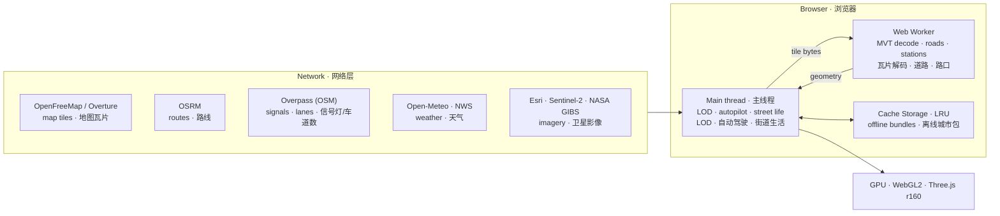
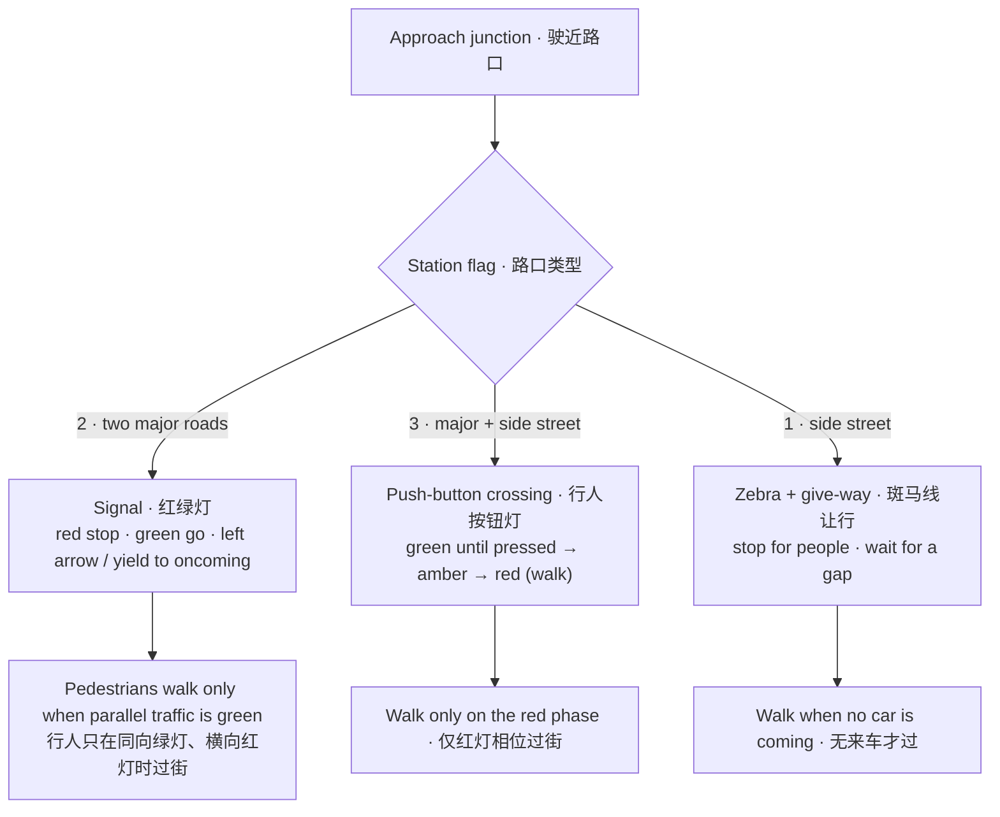
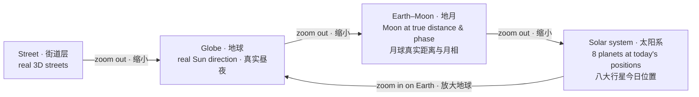

# Sentinel Earth · 安全地球

CSE635 security-education globe · 安全教育三维地球 · 보안 교육용 3D 지구본 · 3D-Globus für die Sicherheitslehre

```
 Globe (static overview)  ──click a city──▶  Street level (dynamic)
 ├─ 7,342 places, clusters                 ├─ live OpenStreetMap tiles, 3×3 streamed while you move
 ├─ 238 verified security events            ├─ real sun & moon · sky · clouds · fog · rain · snow · storm
 └─ timeline 1971 → today                   ├─ seasonal trees · street lamps · lit windows at night
                                            └─ environmental security posture panel
```







---

## 中文

**这是什么**：一个可以直接部署的静态网站。地球层显示全球城市和经过核实的安全事件时间线；点任意城市进入街道层，看真实街区的三维模型。

**街道层环境（按真实条件计算）**
- **昼夜**：太阳和月亮的位置按城市经纬度和当前时间计算，日出日落、月相都是真实的。可以切换「实时」、拖动时间条，或者用「延时」看一整天的变化。
- **天气**：部署后自动从 Open-Meteo 获取实况（云量、能见度、风、降水、雷暴、温度），也可以手动切换晴、多云、阴、雾、雨、雷暴、雪。
- **生态**：公园和林地种树，道路两侧有行道树，树叶颜色按季节和南北半球变化，风大时树会摆动，下雪时树冠和屋顶会积雪。
- **夜间照明**：天暗到路灯光控的亮灯阈值后，路灯自动亮起；窗户亮灯的比例随当地时刻变化。
- **环境安全态势**：根据照度、能见度、风、降水、雷电、温度和时段七项条件，给出监控成像、无人机巡检、防水防雷、值守等方面的通用参考。这只是针对环境条件的教学参考，不评估任何具体建筑。

**城市互联与导航**
- 街道层左上是小地球（方位指针），右上是 XYZ 空间坐标，右下「前方临近」列出朝向前方 400 km 内的城镇和最近的邻国。
- 点列表里的城市名，镜头会沿地面一路飞过去，沿途街区块实时加载，相邻城市连成一张图。速度可选慢、中、快，按 WASD 或 Esc 随时停下。
- 连不上地图服务器时，后台会自动重试；加载失败的街区块也会自动重试。视野可以在 3×3 和 5×5 街区块之间切换。

**天眼视角**
- 街道层「天眼视角」按钮（或按 V）切换到近垂直的卫星视角，地面铺上公开卫星影像（Esri World Imagery；连不上时改用 EOX Sentinel-2 2016）。这是历史晴空拼接底图，不是实时拍摄。
- 画面上显示 MGRS/UTM 坐标、地面分辨率、视幅、太阳高度和方位，可以叠加 1 km 网格（G 键）。传感器模式有可见光、全色、夜视和伪彩热（模拟）。
- 右侧列出视野中心 300 km 内的时间线安全事件，点开就能看详情。巡航到别的城市时保持天眼视角。

**天眼侦测手段**
- 影像源：Esri 高分辨率、Sentinel-2、NASA MODIS/VIIRS 每日近实时影像（可选日期，能看到当天真实云层）、VIIRS 夜间灯光、Esri Wayback 历史存档（2014 年起，可拖动分屏做变化对比）。
- 传感器：可见光、全色、夜视、植被指数 ExG（由可见光波段计算）、建筑高度 DSM、SAR 雷达（模拟）、伪彩热（模拟）。
- 情报面板：附近安全事件、当前上空与未来 2 小时过境的卫星（CelesTrak 轨道根数加 SGP4 计算）、USGS 近 7 天地震、NASA EONET 自然灾害。
- 工具：降水雷达叠加（RainViewer）、测距与面积（M 键）、UTM 网格（G 键）。界面中英文切换。

**地址搜索与昼夜**
- 街道层顶部有搜索框：输入地址、街道、地点或城市（OpenStreetMap 的 Photon / Nominatim 检索），近处的结果沿地面飞过去，远处的直接落到街道层，并插上黄色定位针。
- 环境面板新增「黎明 / 白天 / 黄昏 / 黑夜」时段按钮，按当地真实日出日落计算。天眼开启「昼夜联动」时，黑夜会把影像调暗并叠加 VIIRS 夜间灯光，提示改用夜视、热红外或 SAR。

**安全大脑事件库**
- 时间线现在有 238 起经过核实的事件。每起事件标注「安全大脑」分层（1 全球/美国、2 中国、3 欧洲、4 亚太/中东/美洲），并注明通报或分析它的机构，例如 CISA、CNCERT、ENISA、JPCERT。
- 时间线下方可以按分层筛选，也可以只看有机构通报的事件。

**全球连贯**
- 地球层对着任意陆地一直放大（或双击陆地），就会直接落到那里的街道层，不限于城市列表。街道层一直缩小，又会回到地球层的同一位置。街道层里可以沿地面一路飞到任何地方，沿途的街区边飞边加载。

**数据覆盖扫描**
- 地球层打开「覆盖」，每座城市按中心建筑密度标成 A 完整、B 良好、C 稀疏、D 缺失四个等级。
- 「深度扫描」实时读取周围 3×3 街区块，判断原因是坐标偏了、OSM 缺建筑，还是当地本来就稀疏；坐标偏了的城市可以一键采用新中心点。
- 报告可以导出为 CSV 或 JSON。
- OpenStreetMap 建筑稀少的街区块，实时模式会自动用 Overture Maps 建筑数据补全（OSM 加上 Microsoft、Google 的机器学习建筑轮廓）。

**自动驾驶与街道生活**
- 街道层「驾驶视角」：设目的地后按 OSRM 真实路线行驶（不是瞬移），可选驾驶舱、追尾、无人机伴飞视角；伴飞镜头会按当地地形和楼高避开遮挡，始终看得到车。
- 交通规则：两条主路相交是红绿灯（含左转保护箭头、绿波）；主路和小街相交是行人按钮信号灯；小街路口是斑马线加让行线。不再到处放 STOP 牌，只保留 OpenStreetMap 里真实标注的 STOP。
- 车道：按 OpenStreetMap 的 lanes 标签模拟真实车道数（查不到用道路等级的默认值），区分单行道和双行道。车只在车道中间行驶，不压线；左转前并到靠中线的车道、在停止线前等灯并礼让对向车，右转并到最外侧车道；到达终点靠边停车。
- 街道生活：车辆、行人、狗和猫按同一套规则运行：红灯停、绿灯行，车辆礼让行人，行人只走人行道和斑马线。

**太阳系**
- 地球层打开「太阳系」：太阳在真实方向上（地球的昼夜分界线和此刻一致），月球在真实距离和月相上，水星到海王星出现在它们此刻在天空中的真实方向。
- 一直缩小，先看到地月系统，再进入「太阳系视角」：八大行星按今天的真实位置排在各自轨道上，可以点任意行星看半径、离太阳和离地球的距离、光行时间、公转和自转周期。土星环和天王星的自转轴按真实朝向画出。
- 底部时间条：实时、暂停、1 天/秒、1 周/秒、1 月/秒、1 年/秒。位置用 Schlyter 低精度星历计算（约 1–2 角分）；太阳系视角里的距离和大小经过压缩，不是真实比例。

**语言：中文 / EN / 双语**
- 右上角三个按钮切换：中文、English、双语（中英并排，例如「限速 / LIMIT」）。选择会记在浏览器里。
- 所有界面文字集中在语言包 `i18n.js`：`ui` 是界面标签，`s` 是其余全部屏幕文字（抬头显示、面板、提示、驾驶、天眼、街道生活），每条都是「键 → [中文, English]」。`pick()` 是三种模式共用的取词规则。新增文字时在语言包里加一个键，代码里用 `I18T('键')` 调用。

**本地运行**：双击 `start-sentinel-earth.bat`（Windows），或运行 `python srv.py 8000`，再打开 http://localhost:8000 。`data/bundles` 里是离线城市包，没有网络时也能看这些城市。

**部署**：这个文件夹就是网站本身，不需要构建步骤。
- Vercel：在文件夹里运行 `vercel deploy`，或者把它推到 GitHub 再在 Vercel 导入。
- Netlify：把文件夹拖到 app.netlify.com/drop。

**数据来源**：© OpenStreetMap 贡献者 · OpenMapTiles · OpenFreeMap（街道矢量瓦片）· Overture Maps Foundation（建筑补全）· NASA GIBS / EONET · USGS · CelesTrak · RainViewer · Esri Wayback · Open-Meteo（天气，CC BY 4.0）· NASA（地球影像）。

## English

**What it is**: a static, deployable website. The globe shows cities worldwide and a verified security-event timeline. Click any city to drop to a 3D model of its real streets.

**Street-level environment (computed from real conditions)**
- **Day and night**: sun and moon positions are computed from the city's coordinates and the current time, so sunrise, sunset and moon phase are real. Use Live, drag the time slider, or run a time-lapse.
- **Weather**: the deployed site pulls live conditions from Open-Meteo (cloud, visibility, wind, precipitation, thunder, temperature). Presets are also available: clear, cloudy, overcast, fog, rain, storm and snow.
- **Ecology**: parks and woods are planted with trees, and streets get street trees. Foliage follows the season and the hemisphere, sways in the wind and gathers snow.
- **Night lighting**: street lamps switch on at the usual photocell threshold, and the share of lit windows follows the local hour.
- **Environmental security posture**: seven conditions (illumination, visibility, wind, precipitation, lightning, temperature, time window) give generic guidance on CCTV imaging, drone patrol, flood and surge protection, and staffing. It is a teaching reference about conditions, not an assessment of any specific building.

**Connected cities and navigation**
- At street level, a mini globe with a heading pointer sits top left and an XYZ gizmo top right. The "Next up" radar at bottom right lists places within 400 km ahead and the nearest neighbouring country.
- Click a place to glide there over the ground while tiles stream in, so neighbouring cities join into one map. Speed is slow, medium or fast; WASD or Esc stops.
- If the map server is unreachable, the page retries in the background, and failed tiles retry on their own. The view can be 3×3 or 5×5 tiles.

**Sky eye**
- The Sky eye button at street level (or V) switches to a near-vertical satellite view with public imagery on the ground: Esri World Imagery, or EOX Sentinel-2 2016 as a fallback. It is a historical cloud-free mosaic, not live capture.
- The HUD shows MGRS/UTM, ground resolution, swath width and sun position, with an optional 1 km grid (G). Sensor modes: visible, panchromatic, night vision and simulated false-colour thermal.
- A side list shows timeline events within 300 km of the view centre. Travel between cities keeps the sky view.

**Sky-eye sensing**
- Sources: Esri high-res, Sentinel-2, NASA MODIS/VIIRS daily near-real-time imagery (pick the date; shows that day's real clouds), VIIRS night lights, and the Esri Wayback archive (from 2014, with a split-screen change swipe).
- Sensors: visible, panchromatic, night vision, vegetation ExG (computed from visible bands), building-height DSM, SAR (simulated), thermal (simulated).
- Intel panel: nearby events, satellites overhead now and passing in the next 2 h (CelesTrak elements + SGP4), USGS earthquakes from the past 7 days, NASA EONET natural hazards.
- Tools: precipitation radar overlay (RainViewer), distance and area measuring (M), UTM grid (G). All labels switch between Chinese, English and bilingual.

**Address search and day/night**
- A search box at the top of street level finds addresses, streets, places and cities (OpenStreetMap Photon / Nominatim). Nearby results fly there over the ground; distant ones drop straight in, marked with a yellow pin.
- The environment panel has Dawn / Day / Dusk / Night buttons from the real local sunrise and sunset. With "Day/night sync" on, sky eye dims the imagery at night and overlays VIIRS night lights, pointing to night vision, thermal or SAR instead.

**Source-tier event library**
- The timeline now holds 238 verified events. Each carries its source tier (1 global/US, 2 China, 3 Europe, 4 APAC/Middle East/Americas) and the organisations that reported or analysed it, such as CISA, CNCERT, ENISA or JPCERT.
- Below the timeline you can filter by tier, or show only events an organisation reported.

**One continuous world**
- On the globe, keep zooming into any land (or double-click it) to drop straight to street level there, not only at listed cities. Keep zooming out at street level to rise back to the globe at the same spot. At street level you can fly anywhere over the ground, and streets load as you go.

**Coverage scan**
- Turn on "Coverage" on the globe to grade every city by building density at its centre: A complete, B good, C sparse, D missing.
- A deep scan reads the 3×3 tiles around the centre to tell an off-centre coordinate from missing OSM footprints or a genuinely sparse place. Off-centre cities can be re-centred in one click.
- The report exports as CSV or JSON.
- Where OpenStreetMap has few buildings, live mode fills the tile from Overture Maps building data (OSM plus Microsoft and Google machine-learned footprints).

**Autopilot and street life**
- Drive view at street level: set a destination and the car follows a real OSRM route (no teleporting). Cockpit, chase and drone-escort cameras; the escort camera avoids buildings and terrain so the car stays in view.
- Traffic rules: two major roads meet at traffic signals (protected left arrow, green wave); a side street joining a major road gets a pedestrian push-button signal; side-street junctions get a zebra crossing with a give-way line. No blanket STOP signs; only STOP signs actually mapped in OpenStreetMap are kept.
- Lanes: real lane counts from the OpenStreetMap lanes tag (class defaults where it is missing), one-way and two-way roads. Cars stay centred in a lane; before a left turn they move to the lane by the centre line and wait at the stop line, giving way to oncoming traffic; right turns use the outside lane; at the destination the car pulls over to the kerb.
- Street life: cars, pedestrians, dogs and cats follow the same rules: stop on red, go on green, cars give way to people, people walk only on pavements and crossings.

**Solar system**
- Turn on "Solar system" on the globe: the Sun sits in its true direction (Earth's day/night line matches this moment), the Moon at its true distance and phase, and Mercury to Neptune in their true directions in the sky.
- Keep zooming out to see the Earth–Moon system, then the solar-system view: the eight planets at today's real positions on their orbits. Click any planet for its radius, distance from the Sun and from Earth, light time, and orbital and rotation periods. Saturn's rings and Uranus's axis are drawn in their real orientation.
- Time bar at the bottom: live, pause, 1 day/s, 1 week/s, 1 month/s, 1 year/s. Positions come from Schlyter's low-precision ephemeris (about 1–2′); distances and sizes in the solar-system view are compressed, not to scale.

**Language: 中文 / EN / 双语 (bilingual)**
- Three buttons at the top right: Chinese, English and bilingual (both side by side, e.g. "限速 / LIMIT"). The choice is remembered in the browser.
- Every interface string lives in the language pack `i18n.js`: `ui` holds interface labels, `s` holds every other on-screen string (HUDs, panels, toasts, driving, sky eye, street life), each as key → [Chinese, English]. `pick()` is the one rule all three modes use. To add a string, add a key to the pack and call `I18T('key')` in the code.

**Run locally**: double-click `start-sentinel-earth.bat` (Windows) or run `python srv.py 8000`, then open http://localhost:8000. `data/bundles` holds offline city bundles that work without a network.

**Deploy**: this folder is the site itself; there is no build step.
- Vercel: run `vercel deploy` in the folder, or push it to GitHub and import it in Vercel.
- Netlify: drag the folder onto app.netlify.com/drop.

**Data**: © OpenStreetMap contributors · OpenMapTiles · OpenFreeMap (street tiles) · Overture Maps Foundation (building fill) · NASA GIBS / EONET · USGS · CelesTrak · RainViewer · Esri Wayback · Open-Meteo (weather, CC BY 4.0) · NASA (imagery).

## 한국어

**개요**: 바로 배포할 수 있는 정적 웹사이트입니다. 지구본에는 전 세계 도시와 검증된 보안 사건 타임라인이 표시됩니다. 도시를 클릭하면 실제 거리의 3D 모델로 들어갑니다.

**거리 레벨 환경 (실제 조건으로 계산)**
- **낮과 밤**: 태양과 달의 위치를 도시의 위경도와 현재 시각으로 계산하므로 일출, 일몰, 달의 위상이 실제와 같습니다. 실시간, 시간 슬라이더, 타임랩스를 지원합니다.
- **날씨**: 배포 사이트는 Open-Meteo에서 실황을 받아옵니다(구름, 가시거리, 바람, 강수, 뇌우, 기온). 맑음, 구름, 흐림, 안개, 비, 뇌우, 눈 프리셋도 있습니다.
- **생태**: 공원과 숲에는 나무를 심고, 도로에는 가로수를 둡니다. 잎 색은 계절과 반구에 따라 바뀌고, 바람에 흔들리며, 눈이 오면 쌓입니다.
- **야간 조명**: 일반적인 광센서 기준에 맞춰 가로등이 켜지고, 창문이 켜지는 비율은 현지 시각에 따라 달라집니다.
- **환경 보안 태세**: 조도, 가시거리, 바람, 강수, 낙뢰, 기온, 시간대의 일곱 가지 조건으로 CCTV 영상, 드론 순찰, 침수·서지 보호, 근무 인원에 대한 일반적인 참고 정보를 보여 줍니다. 환경 조건에 대한 교육용 참고 자료이며, 특정 건물을 평가하지 않습니다.

**도시 연결과 내비게이션**
- 거리 레벨 왼쪽 위에는 방위 포인터가 있는 미니 지구본, 오른쪽 위에는 XYZ 좌표축이 있습니다. 오른쪽 아래 "전방 근접" 레이더는 진행 방향 400 km 안의 도시와 가장 가까운 이웃 나라를 보여 줍니다.
- 목록의 도시를 클릭하면 지면을 따라 날아가며 타일을 실시간으로 불러오므로, 이웃 도시가 하나의 지도로 이어집니다. 속도는 느림·보통·빠름이며 WASD나 Esc로 멈춥니다.
- 지도 서버에 연결되지 않으면 백그라운드에서 다시 시도하고, 실패한 타일도 자동으로 다시 불러옵니다. 시야는 3×3 또는 5×5 타일입니다.

**천안(위성) 시점**
- 거리 레벨의 "천안 시점" 버튼(또는 V)을 누르면 거의 수직인 위성 시점으로 바뀌고, 지면에 공개 위성 영상(Esri World Imagery, 실패하면 EOX Sentinel-2 2016)이 깔립니다. 과거의 맑은 날 영상을 모은 모자이크이며 실시간 촬영이 아닙니다.
- 화면에는 MGRS/UTM 좌표, 지상 해상도, 촬영 폭, 태양 위치가 표시되고 1 km 격자(G)를 겹칠 수 있습니다. 센서 모드는 가시광, 전정색, 야간 투시, 모의 열적외선입니다.
- 옆 목록에는 시야 중심 300 km 안의 타임라인 사건이 나옵니다. 도시 사이를 이동해도 위성 시점이 유지됩니다.

**천안 탐지 수단**
- 영상 소스: Esri 고해상도, Sentinel-2, NASA MODIS/VIIRS 일일 준실시간 영상(날짜 선택, 그날의 실제 구름 표시), VIIRS 야간 조명, Esri Wayback 역사 아카이브(2014년부터, 화면 분할 변화 비교).
- 센서: 가시광, 전정색, 야간 투시, 식생 지수 ExG(가시광 밴드로 계산), 건물 높이 DSM, SAR(모의), 열적외선(모의).
- 정보 패널: 주변 사건, 현재 상공과 향후 2시간 통과 위성(CelesTrak 궤도 요소 + SGP4), USGS 최근 7일 지진, NASA EONET 자연재해.
- 도구: 강수 레이더 오버레이(RainViewer), 거리·면적 측정(M), UTM 격자(G). 모든 표시는 중국어/영어 전환을 지원합니다.

**주소 검색과 낮/밤**
- 거리 레벨 상단 검색창에서 주소, 거리, 장소, 도시를 찾습니다(OpenStreetMap Photon / Nominatim). 가까운 결과는 지면을 따라 날아가고, 먼 결과는 바로 내려가며 노란 핀으로 표시됩니다.
- 환경 패널에 실제 일출·일몰로 계산한 새벽 / 낮 / 황혼 / 밤 버튼이 있습니다. 천안의 "낮밤 연동"을 켜면 밤에는 영상을 어둡게 하고 VIIRS 야간 조명을 겹쳐, 야간 투시·열적외선·SAR 사용을 안내합니다.

**보안 두뇌 사건 라이브러리**
- 타임라인에는 이제 검증된 사건 238건이 있습니다. 각 사건에는 출처 계층(1 글로벌/미국, 2 중국, 3 유럽, 4 아태/중동/미주)과 이를 보고하거나 분석한 기관(CISA, CNCERT, ENISA, JPCERT 등)이 표시됩니다.
- 타임라인 아래에서 계층별로 거르거나, 기관이 보고한 사건만 볼 수 있습니다.

**하나로 이어진 세계**
- 지구본에서 아무 육지나 계속 확대하거나 더블클릭하면 그곳의 거리 레벨로 바로 내려갑니다(도시 목록에 없는 곳도 가능). 거리 레벨에서 계속 축소하면 같은 위치의 지구본으로 돌아옵니다. 거리 레벨에서는 지면을 따라 어디든 날아갈 수 있고, 지나가는 곳의 거리가 실시간으로 로드됩니다.

**데이터 커버리지 스캔**
- 지구본에서 "커버리지"를 켜면 도시마다 중심부 건물 밀도에 따라 A 완전, B 양호, C 희박, D 누락 등급이 표시됩니다.
- 정밀 스캔은 중심 주변 3×3 타일을 실시간으로 읽어 좌표가 어긋났는지, OSM에 건물이 없는지, 원래 한산한 곳인지 구분합니다. 좌표가 어긋난 도시는 클릭 한 번으로 중심을 옮길 수 있습니다.
- 보고서는 CSV나 JSON으로 내보낼 수 있습니다.
- OpenStreetMap 건물이 적은 타일은 실시간 모드에서 Overture Maps 건물 데이터(OSM과 Microsoft·Google의 머신러닝 건물 윤곽)로 자동 보완됩니다.

**자율 주행과 거리 생활**
- 거리 레벨 "주행 시점": 목적지를 정하면 OSRM 실제 경로를 따라 달립니다(순간이동 없음). 운전석, 추적, 드론 동행 카메라가 있으며, 동행 카메라는 지형과 건물 높이를 고려해 가려지지 않고 항상 차를 비춥니다.
- 교통 규칙: 간선도로끼리 만나는 곳은 신호등(좌회전 보호 화살표, 녹색 신호 연동), 간선도로와 골목이 만나는 곳은 보행자 버튼 신호, 골목 교차로는 횡단보도와 양보선입니다. STOP 표지는 OpenStreetMap에 실제로 표시된 것만 남겼습니다.
- 차로: OpenStreetMap의 lanes 태그로 실제 차로 수를 재현하고(없으면 도로 등급 기본값), 일방통행과 양방향을 구분합니다. 차는 차로 한가운데로만 달리고 선을 밟지 않습니다. 좌회전 전에는 중앙선 쪽 차로로 옮겨 정지선 앞에서 신호를 기다리며 맞은편 차에 양보하고, 우회전은 바깥 차로를 씁니다. 목적지에서는 길가에 세웁니다.
- 거리 생활: 차, 보행자, 개와 고양이가 같은 규칙을 따릅니다. 빨간불에 서고 초록불에 가며, 차는 보행자에게 양보하고, 보행자는 보도와 횡단보도로만 다닙니다.

**태양계**
- 지구본에서 "태양계"를 켜면 태양이 실제 방향에 놓이고(지구의 낮밤 경계가 지금과 같음), 달은 실제 거리와 위상으로, 수성부터 해왕성까지는 지금 하늘에서의 실제 방향에 나타납니다.
- 계속 축소하면 지구–달 시스템을 거쳐 "태양계 시점"으로 들어가, 여덟 행성이 오늘의 실제 위치로 궤도 위에 놓입니다. 행성을 클릭하면 반지름, 태양·지구까지의 거리, 빛의 도달 시간, 공전·자전 주기를 볼 수 있습니다. 토성 고리와 천왕성 자전축은 실제 방향으로 그립니다.
- 아래 시간 막대: 실시간, 일시정지, 1일/초, 1주/초, 1개월/초, 1년/초. 위치는 Schlyter 저정밀 천체력(약 1–2′)으로 계산하며, 태양계 시점의 거리와 크기는 압축되어 실제 비율이 아닙니다.

**언어: 中文 / EN / 双语(이중 언어)**
- 오른쪽 위 세 버튼으로 중국어, 영어, 이중 언어(두 언어를 나란히, 예: "限速 / LIMIT")를 고릅니다. 선택은 브라우저에 저장됩니다.
- 모든 화면 문구는 언어 팩 `i18n.js`에 모여 있습니다. `ui`는 인터페이스 라벨, `s`는 그 밖의 모든 화면 문구(HUD, 패널, 알림, 주행, 천안, 거리 생활)이며 각 항목은 키 → [중국어, 영어]입니다. `pick()`은 세 모드가 함께 쓰는 선택 규칙입니다. 문구를 추가하려면 언어 팩에 키를 넣고 코드에서 `I18T('키')`로 부릅니다.

**로컬 실행**: Windows에서 `start-sentinel-earth.bat`를 더블클릭하거나 `python srv.py 8000`을 실행한 뒤 http://localhost:8000 을 엽니다. `data/bundles`에는 네트워크 없이도 볼 수 있는 오프라인 도시 데이터가 있습니다.

**배포**: 이 폴더가 곧 사이트이며, 빌드 단계는 없습니다.
- Vercel: 폴더에서 `vercel deploy`를 실행하거나, GitHub에 올린 뒤 Vercel에서 가져옵니다.
- Netlify: 폴더를 app.netlify.com/drop에 끌어다 놓습니다.

**데이터**: © OpenStreetMap 기여자 · OpenMapTiles · OpenFreeMap · Open-Meteo (CC BY 4.0) · NASA.

## Deutsch

**Worum es geht**: eine statische, direkt deploybare Website. Der Globus zeigt Städte weltweit und eine verifizierte Zeitleiste von Sicherheitsvorfällen. Ein Klick auf eine Stadt öffnet ein 3D-Modell ihrer realen Straßen.

**Umgebung auf Straßenebene (aus realen Bedingungen berechnet)**
- **Tag und Nacht**: Sonnen- und Mondstand werden aus den Koordinaten der Stadt und der aktuellen Zeit berechnet; Sonnenaufgang, Sonnenuntergang und Mondphase sind also real. Es gibt Live-Modus, Zeitregler und Zeitraffer.
- **Wetter**: Die deployte Seite lädt aktuelle Bedingungen von Open-Meteo (Bewölkung, Sicht, Wind, Niederschlag, Gewitter, Temperatur). Dazu kommen Voreinstellungen: klar, bewölkt, bedeckt, Nebel, Regen, Gewitter und Schnee.
- **Ökologie**: Parks und Wälder werden bepflanzt, Straßen bekommen Straßenbäume. Das Laub folgt Jahreszeit und Hemisphäre, wiegt sich im Wind und trägt Schnee.
- **Nachtbeleuchtung**: Straßenlaternen schalten an der üblichen Dämmerungsschwelle, und der Anteil beleuchteter Fenster folgt der Ortszeit.
- **Umweltbezogene Sicherheitslage**: Sieben Bedingungen (Beleuchtungsstärke, Sicht, Wind, Niederschlag, Blitz, Temperatur, Zeitfenster) liefern allgemeine Hinweise zu Videobild, Drohnenstreife, Wasser- und Überspannungsschutz sowie Personalstärke. Das ist eine Lehrreferenz zu Bedingungen, keine Bewertung bestimmter Gebäude.

**Verbundene Städte und Navigation**
- Auf Straßenebene zeigt oben links ein Mini-Globus mit Richtungszeiger und oben rechts ein XYZ-Achsenkreuz. Das Radar "Voraus" unten rechts listet Orte bis 400 km in Blickrichtung und das nächste Nachbarland.
- Ein Klick auf einen Ort lässt die Kamera über den Boden dorthin gleiten, während Kacheln nachladen; so verbinden sich Nachbarstädte zu einer Karte. Tempo langsam, mittel oder schnell; WASD oder Esc stoppt.
- Ist der Kartenserver nicht erreichbar, versucht die Seite es im Hintergrund erneut, und fehlgeschlagene Kacheln laden automatisch nach. Sichtbereich 3×3 oder 5×5 Kacheln.

**Himmelsauge (Satellitenansicht)**
- Die Schaltfläche "Himmelsauge" auf Straßenebene (oder V) wechselt in eine fast senkrechte Satellitenansicht mit öffentlichem Bildmaterial am Boden: Esri World Imagery, ersatzweise EOX Sentinel-2 2016. Es ist ein historisches, wolkenfreies Mosaik, keine Live-Aufnahme.
- Das HUD zeigt MGRS/UTM, Bodenauflösung, Streifenbreite und Sonnenstand, dazu optional ein 1-km-Gitter (G). Sensormodi: sichtbar, panchromatisch, Nachtsicht und simuliertes Falschfarben-Thermal.
- Eine Seitenliste zeigt Zeitleisten-Ereignisse im Umkreis von 300 km. Beim Reisen zwischen Städten bleibt die Satellitenansicht erhalten.

**Himmelsauge: Erfassungsarten**
- Quellen: Esri hochauflösend, Sentinel-2, tägliche NASA-MODIS/VIIRS-Bilder nahezu in Echtzeit (Datum wählbar, zeigt die echten Wolken des Tages), VIIRS-Nachtlichter und das Esri-Wayback-Archiv (ab 2014, mit geteiltem Bildschirm zum Änderungsvergleich).
- Sensoren: sichtbar, panchromatisch, Nachtsicht, Vegetationsindex ExG (aus den sichtbaren Kanälen berechnet), Gebäudehöhen-DSM, SAR (simuliert), Thermal (simuliert).
- Lagepanel: Ereignisse in der Nähe, Satelliten über dem Horizont und Überflüge der nächsten 2 h (CelesTrak-Bahnelemente + SGP4), USGS-Erdbeben der letzten 7 Tage, NASA-EONET-Naturereignisse.
- Werkzeuge: Niederschlagsradar (RainViewer), Distanz- und Flächenmessung (M), UTM-Gitter (G). Alle Beschriftungen auf Chinesisch und Englisch.

**Adresssuche und Tag/Nacht**
- Ein Suchfeld oben auf Straßenebene findet Adressen, Straßen, Orte und Städte (OpenStreetMap Photon / Nominatim). Nahe Treffer werden angeflogen, entfernte direkt geöffnet und mit einer gelben Nadel markiert.
- Das Umweltpanel hat Tasten für Morgendämmerung / Tag / Abenddämmerung / Nacht nach echtem Sonnenauf- und -untergang. Mit „Tag/Nacht-Kopplung“ dunkelt das Himmelsauge nachts das Bild ab, legt VIIRS-Nachtlichter darüber und verweist auf Nachtsicht, Thermal oder SAR.

**Ereignisbibliothek nach Quellenebenen**
- Die Zeitleiste enthält jetzt 238 verifizierte Ereignisse. Jedes trägt seine Quellenebene (1 global/USA, 2 China, 3 Europa, 4 Asien-Pazifik/Nahost/Amerika) und die Organisationen, die es gemeldet oder analysiert haben, etwa CISA, CNCERT, ENISA oder JPCERT.
- Unter der Zeitleiste lässt sich nach Ebene filtern oder nur auf Ereignisse beschränken, die eine Organisation gemeldet hat.

**Eine zusammenhängende Welt**
- Auf dem Globus über beliebigem Land weiter hineinzoomen (oder doppelklicken) führt direkt auf die Straßenebene dort, nicht nur bei gelisteten Städten. Auf Straßenebene weiter herauszoomen führt an derselben Stelle zurück zum Globus. Auf Straßenebene lässt sich überallhin über den Boden fliegen; die Straßen laden unterwegs nach.

**Abdeckungs-Scan**
- "Abdeckung" auf dem Globus bewertet jede Stadt nach der Gebäudedichte im Zentrum: A vollständig, B gut, C dünn, D fehlend.
- Ein Tiefenscan liest die 3×3 Kacheln um das Zentrum live und unterscheidet eine verschobene Koordinate von fehlenden OSM-Grundrissen oder einem tatsächlich dünn besiedelten Ort. Verschobene Städte lassen sich mit einem Klick neu zentrieren.
- Der Bericht lässt sich als CSV oder JSON exportieren.
- Wo OpenStreetMap wenige Gebäude kennt, füllt der Live-Modus die Kachel mit Overture-Maps-Gebäudedaten (OSM plus maschinell erkannte Grundrisse von Microsoft und Google).

**Autopilot und Straßenleben**
- Fahransicht auf Straßenebene: Nach Wahl eines Ziels folgt das Auto einer echten OSRM-Route (kein Teleportieren). Cockpit-, Verfolger- und Drohnenbegleit-Kamera; die Begleitkamera weicht Gelände und Gebäuden aus, damit das Auto immer sichtbar bleibt.
- Verkehrsregeln: Wo zwei Hauptstraßen kreuzen, gibt es Ampeln (geschützter Linksabbiegerpfeil, grüne Welle); wo eine Nebenstraße auf eine Hauptstraße trifft, eine Fußgänger-Bedarfsampel; an Kreuzungen von Nebenstraßen Zebrastreifen mit Wartelinie. Keine pauschalen STOP-Schilder mehr; nur in OpenStreetMap tatsächlich eingetragene STOP-Schilder bleiben.
- Fahrstreifen: echte Fahrstreifenzahl aus dem OpenStreetMap-Tag lanes (sonst Standard nach Straßenklasse), Einbahn- und Zweirichtungsstraßen. Autos fahren mittig im Fahrstreifen; vor dem Linksabbiegen ordnen sie sich zur Mittellinie ein, warten an der Haltelinie und lassen Gegenverkehr vor; Rechtsabbieger nutzen den äußeren Fahrstreifen; am Ziel hält das Auto am Fahrbahnrand.
- Straßenleben: Autos, Fußgänger, Hunde und Katzen folgen denselben Regeln: bei Rot halten, bei Grün fahren, Autos lassen Fußgänger vor, Fußgänger gehen nur auf Gehwegen und Überwegen.

**Sonnensystem**
- „Sonnensystem“ auf dem Globus einschalten: Die Sonne steht in ihrer echten Richtung (die Tag-Nacht-Grenze der Erde entspricht diesem Moment), der Mond in echter Entfernung und Phase, Merkur bis Neptun in ihrer echten Richtung am Himmel.
- Weiter herauszoomen zeigt erst das Erde-Mond-System, dann die Sonnensystem-Ansicht: die acht Planeten an ihrer heutigen echten Position auf ihren Bahnen. Ein Klick auf einen Planeten zeigt Radius, Abstand zur Sonne und zur Erde, Lichtlaufzeit sowie Umlauf- und Rotationsdauer. Saturnringe und Uranusachse sind in ihrer echten Ausrichtung gezeichnet.
- Zeitleiste unten: live, Pause, 1 Tag/s, 1 Woche/s, 1 Monat/s, 1 Jahr/s. Die Positionen stammen aus Schlyters Ephemeride niedriger Genauigkeit (etwa 1–2′); Abstände und Größen in der Sonnensystem-Ansicht sind gestaucht, nicht maßstäblich.

**Sprache: 中文 / EN / 双语 (zweisprachig)**
- Drei Schaltflächen oben rechts: Chinesisch, Englisch und zweisprachig (beides nebeneinander, z. B. „限速 / LIMIT“). Die Wahl bleibt im Browser gespeichert.
- Alle Oberflächentexte liegen im Sprachpaket `i18n.js`: `ui` enthält die Oberflächenbeschriftungen, `s` alle übrigen Bildschirmtexte (HUDs, Panels, Hinweise, Fahren, Himmelsauge, Straßenleben), jeweils Schlüssel → [Chinesisch, Englisch]. `pick()` ist die gemeinsame Auswahlregel aller drei Modi. Für einen neuen Text einen Schlüssel ins Paket aufnehmen und im Code `I18T('Schlüssel')` aufrufen.

**Lokal starten**: unter Windows `start-sentinel-earth.bat` doppelklicken oder `python srv.py 8000` ausführen und http://localhost:8000 öffnen. `data/bundles` enthält Offline-Stadtpakete, die ohne Netz funktionieren.

**Deployment**: Dieser Ordner ist die Website selbst; es gibt keinen Build-Schritt.
- Vercel: `vercel deploy` im Ordner ausführen, oder den Ordner auf GitHub pushen und in Vercel importieren.
- Netlify: den Ordner auf app.netlify.com/drop ziehen.

**Daten**: © OpenStreetMap-Mitwirkende · OpenMapTiles · OpenFreeMap · Open-Meteo (CC BY 4.0) · NASA.
