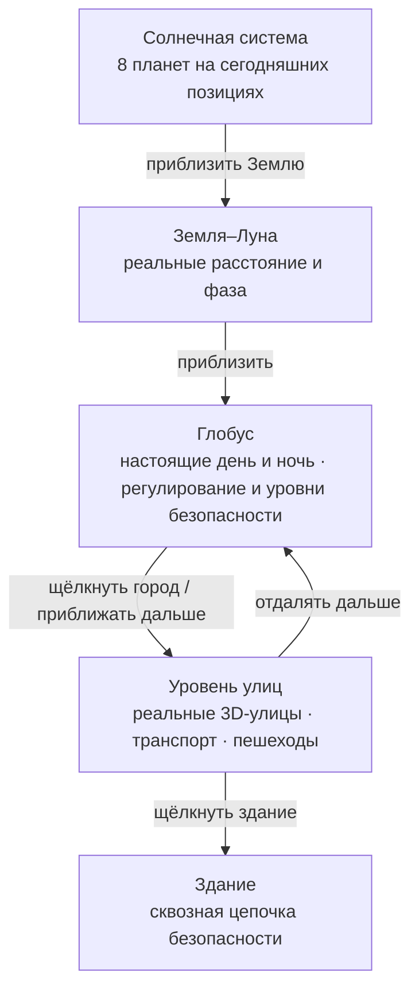
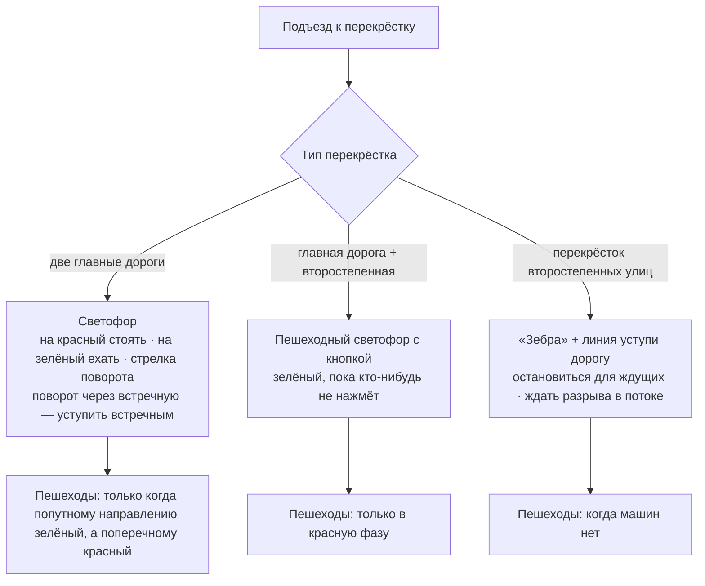
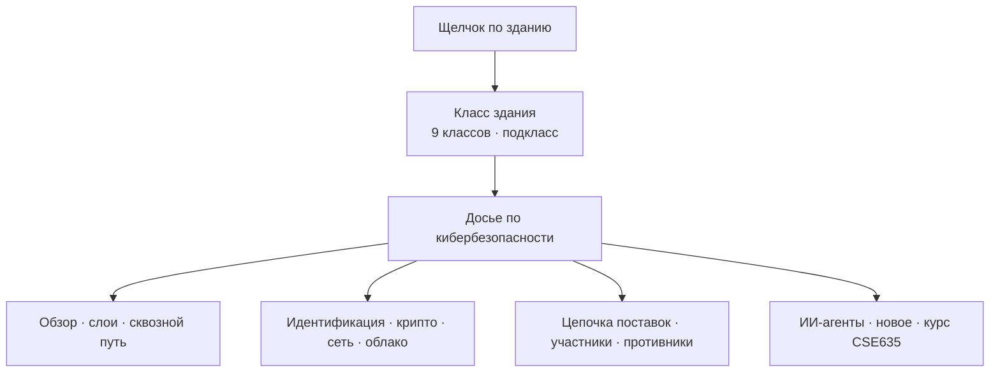
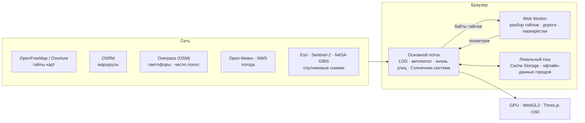

# Безопасная Земля · Sentinel Earth (русский)

[中文](README.zh.md) · [English](README.en.md) · [中英对照](README.zh-en.md) · [한국어](README.ko.md) · [Deutsch](README.de.md) · [日本語](README.ja.md) · **Русский** · [Español](README.es.md) · [Обзор](README.md)

Проект по курсу CSE635 «Инженерия безопасности ПО»: сайт с трёхмерным глобусом, который можно сразу развернуть. Масштаб меняется от всей Солнечной системы до Земли, города, его улиц и отдельного здания; на каждом уровне видны соответствующие знания об архитектуре безопасности.

---

## 1. Уровни масштаба



## 2. Быстрый старт

| Способ | Действия |
|---|---|
| Windows, локально | Дважды щёлкните `start-sentinel-earth.bat`; браузер откроет http://localhost:8000 |
| Любая ОС, локально | В папке проекта выполните `python srv.py 8000` и откройте http://localhost:8000 |
| Развёртывание | Папка и есть сайт, шага сборки нет. Импортируйте этот репозиторий GitHub в Vercel или перетащите папку на app.netlify.com/drop |

> Локальный сервер `srv.py` отключает кэш браузера, поэтому после обновления страницы всегда виден последний код.

### Запуск на своём компьютере (по шагам)

**Шаг 1 · Подготовка**
- Браузер: свежий Chrome, Edge, Firefox или Safari с поддержкой WebGL2 и включённым аппаратным ускорением.
- Python 3.8 или новее: в Windows установите его с python.org и отметьте «Add python.exe to PATH»; в macOS и Linux `python3` обычно уже есть.
- Около 1 ГБ свободного места (сам проект вместе с офлайн-данными городов занимает около 420 МБ). С дискретной видеокартой всё работает плавнее.

**Шаг 2 · Получить код** (любым из способов)
- Скачать в браузере: откройте https://github.com/tianmingliu-pixel/sentinel-earth , нажмите зелёную кнопку «Code» → «Download ZIP» и распакуйте архив в любую папку.
- Через Git: `git clone --depth 1 https://github.com/tianmingliu-pixel/sentinel-earth.git`

**Шаг 3 · Запуск**
- Windows: откройте распакованную папку и дважды щёлкните `start-sentinel-earth.bat`. Появится чёрное окно, и браузер откроется сам.
- macOS / Linux: в терминале выполните `cd sentinel-earth` и `python3 srv.py 8000`, затем откройте в браузере http://localhost:8000 .
- Не закрывайте окно сервера, пока пользуетесь сайтом; закрытие окна или Ctrl+C останавливает сервер.

**Частые проблемы**

| Проблема | Решение |
|---|---|
| Двойной щелчок по `index.html` не работает | Браузеры запрещают страницам напрямую читать локальные файлы данных; откройте сайт через локальный сервер, как в шаге 3 |
| Порт 8000 уже занят | Возьмите другой порт, например `python srv.py 8080`, и откройте http://localhost:8080 |
| Пустая страница или всё очень медленно | Включите аппаратное ускорение в настройках браузера; понизьте «Качество» внизу страницы |
| Другие не могут подключиться к моему компьютеру | `srv.py` принимает подключения только с этого компьютера; чтобы поделиться сайтом, разверните его на Vercel или Netlify |
| Обновиться до последней версии | При работе через Git выполните `git pull`; если скачивали ZIP, скачайте его заново |

> Сеть: 3D-движок лежит в папке проекта `lib/`, поэтому сайт открывается и без интернета; глобус и города с офлайн-данными работают как обычно. Живым улицам, маршрутам, погоде и спутниковым снимкам нужен интернет.

---

## 3. Возможности

### 3.1 Глобус
- Перетаскивание вращает глобус, прокрутка меняет масштаб. Щелчок по стране показывает её уровень безопасности (от SL1 «открытый» до SL5 «критический») и нормативную базу.
- Хронология из 238 проверенных инцидентов безопасности (с 1971 года до наших дней) с фильтрами по уровню источника и по инцидентам, о которых сообщили организации.
- Список «Перелететь» по умолчанию показывает по одной столице на страну или регион (225), сгруппированные по континентам; поиск охватывает все 2353 места.
- Сканирование покрытия оценивает каждый город от A до D по плотности застройки в центре; отчёт выгружается в CSV или JSON.

### 3.2 Солнечная система
- Включите «Солнечная система» на глобусе: Солнце стоит в своём реальном направлении, поэтому граница дня и ночи на Земле совпадает с текущим моментом; Луна находится на реальном расстоянии и в реальной фазе; планеты от Меркурия до Нептуна видны в их реальных направлениях на небе.
- Если продолжать отдалять, сначала видна система Земля–Луна, затем вид Солнечной системы со всеми восемью планетами на их сегодняшних позициях на орбитах. Щелчок по планете показывает радиус, расстояние до Солнца и до Земли, время прохождения света, период обращения и период вращения.
- Шкала времени внизу: в реальном времени, пауза, 1 день/с, 1 неделя/с, 1 месяц/с, 1 год/с.
- Позиции рассчитываются по эфемеридам низкой точности Шлютера (около 1–2′). Расстояния и размеры в виде Солнечной системы сжаты и не соответствуют реальному масштабу.

### 3.3 Уровень улиц
- Улицы OpenStreetMap подгружаются по мере движения; кварталы с малым числом зданий дополняются данными Overture Maps.
- Здания окрашены по назначению (жильё, торговля, госучреждения, больницы, образование…). Щелчок по зданию показывает сквозную цепочку безопасности от пользователя до серверной части.
- Настоящие Солнце и Луна, облака, туман, дождь, снег и грозы, сезонные деревья вдоль улиц, ночные фонари и освещённые окна.
- «Небесное око»: спутниковые снимки, координаты MGRS/UTM, несколько режимов датчиков, ближайшие инциденты, пролетающие спутники, землетрясения и стихийные бедствия.

### 3.4 Автопилот и правила движения



- После выбора пункта назначения машина едет по реальному маршруту OSRM (без телепортации). Есть камеры из кабины, сзади и с сопровождающего дрона.
- Число полос берётся из тега OpenStreetMap `lanes`, а если его нет — по умолчанию для класса дороги; односторонние и двусторонние дороги учитываются отдельно. Машины держатся середины полосы.
- Перед поворотом через встречную полосу (налево при правостороннем движении) машина перестраивается к осевой линии и ждёт у стоп-линии; обратный поворот выполняется из крайней внешней полосы; в пункте назначения машина паркуется у бордюра.
- Окружающие машины, пешеходы, собаки и кошки следуют тем же правилам. Пешеходы ходят только по тротуарам и переходам.
- Знаки STOP оставлены только там, где они действительно нанесены в OpenStreetMap.

### 3.5 Язык: 中文 / EN / 双语
- Три кнопки в правом верхнем углу; двуязычный режим показывает оба языка рядом, например «限速 / LIMIT». Выбор сохраняется в браузере.
- Все тексты интерфейса находятся в языковом пакете `i18n.js` (см. раздел 5).

### 3.6 Досье по кибербезопасности



- На уровне улиц щёлкните любое здание и нажмите в панели «🛰 Досье по кибербезопасности» (кнопка есть и в панели каждого класса зданий). Откроется полноэкранное досье для класса этого здания.
- 13 вкладок: обзор · слои · сквозной путь · идентификация и токены · криптография и алгоритмы · сеть, маршрутизация и линии · облако и данные · цепочка поставок и патчи · участники (компании / государство / жители / поставщики / операторы) · противники и реагирование · ИИ и агенты · новое и регулирование · связь с курсом CSE635.
- Каждый пункт построен как угроза → мера → компромисс; ◆ отмечает формулировки и кейсы курса CSE635 (STRIDE, BOLA/BFLA, проверка JWT, шлюзы DevSecOps, «модель предлагает, решает слой политик», уровни риска агентов, пакет обеспечения 7-й недели).
- Схемы: радары целей безопасности и STRIDE, кликабельный стек из 8 слоёв, сквозной путь из 14 узлов, последовательность OAuth + PKCE, PDP/PEP нулевого доверия, матрица разделённой ответственности, шлюзы конвейера, воронка приоритетов патчей, тепловая карта ответственности, тактики ATT&CK и цикл реагирования на инциденты.
- У каждого из 9 классов (жильё, коммерция, госучреждения, образование, медицина, промышленность, культура, транспорт, религия) свой уровень экспозиции, ключевые активы, пять главных рисков, нормативная рамка и штабное учение; отметки в чек-листе пакета 7-й недели сохраняются в этом браузере.
- Это учебный материал на уровне класса: он не оценивает реальное здание и не содержит реальных данных об уязвимостях или конфигурации.

---

## 4. Архитектура



- Все вычисления выполняются в браузере; собственного сервера или базы данных нет.
- Сеть используется только для получения данных (тайлов, маршрутов, погоды, снимков), а полученные данные кэшируются в браузере.
- Воркер разбирает тайлы и строит геометрию дорог, основной поток отвечает за взаимодействие и моделирование, а GPU только рисует.

---

## 5. Файлы

```
sentinel-earth/
├─ index.html              структура страницы и стили
├─ app.js                  вся логика приложения (глобус, улицы, вождение, жизнь улиц, Солнечная система…)
├─ i18n.js                 языковой пакет: китайский / английский / двуязычный
├─ dossier.js              досье по кибербезопасности: база знаний + просмотр
├─ data.js                 учебные данные: уровни безопасности, типы зданий, регулирование
├─ data/
│  ├─ cities.json          2353 места (225 столиц)
│  ├─ events.json          238 инцидентов безопасности
│  ├─ nodes.json           сетевые узлы на глобусе
│  ├─ earth/               текстуры Земли и векторы границ
│  ├─ streets/             центральные кварталы городов
│  └─ bundles/             офлайн-данные городов (144 файла, около 416 МБ)
├─ lib/three.min.js       3D-движок Three.js r160 (локальная копия)
├─ LICENSE                 лицензия MIT и сведения о сторонних данных
├─ srv.py                  локальный сервер (без кэша)
├─ start-sentinel-earth.bat  запуск одним щелчком в Windows
├─ vercel.json             настройки развёртывания
└─ README*.md              документация
```

### Как пользоваться языковым пакетом `i18n.js`

| Часть | Содержимое |
|---|---|
| `ui` | подписи интерфейса: заголовок, панели, легенды |
| `s` | все прочие тексты на экране (474): HUD, панели, подсказки, вождение, «небесное око», жизнь улиц, Солнечная система |
| `pick()` | общее правило выбора для всех трёх режимов |

Каждая запись — ключ → [китайский, английский]. Чтобы добавить текст:
1. Добавьте строку в `s` в файле `i18n.js`, например `my_label:['我的标签','My label'],`
2. Выведите её в `app.js` через `I18T('my_label')`.
3. Все три языковых режима подхватят её автоматически.

---

## 6. Источники данных

© участники OpenStreetMap · OpenMapTiles · OpenFreeMap (тайлы улиц) · Overture Maps Foundation (дополнение зданий) · OSRM (маршруты) · Overpass API (светофоры, число полос) · NASA GIBS / EONET · USGS · CelesTrak · RainViewer · Esri Wayback · Open-Meteo (погода, CC BY 4.0) · NASA (снимки Земли) · метод Шлютера для положения планет (Солнечная система).

## 7. Примечания

- Обстановка безопасности по условиям среды и сетевые цепочки зданий — учебный справочный материал, а не оценка конкретных зданий или организаций.
- Где статус столицы оспаривается (например, Израиль, Палестина), в списке указан город, где фактически находятся государственные учреждения.
- Лицензия: код распространяется по лицензии MIT (см. `LICENSE`). Данные об улицах и местах из OpenStreetMap распространяются по ODbL 1.0; при повторном использовании сохраняйте указание авторства.
