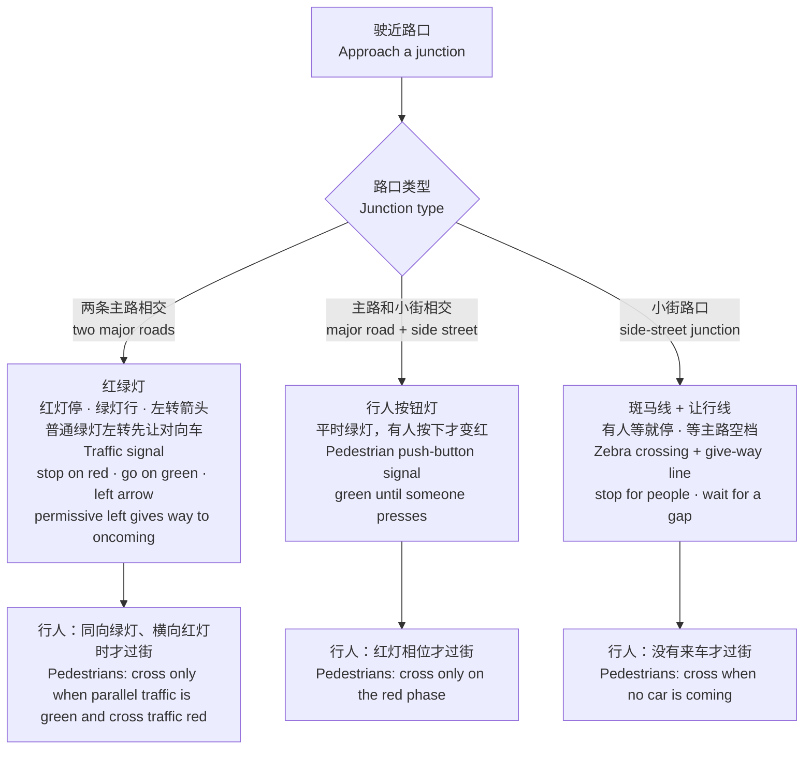
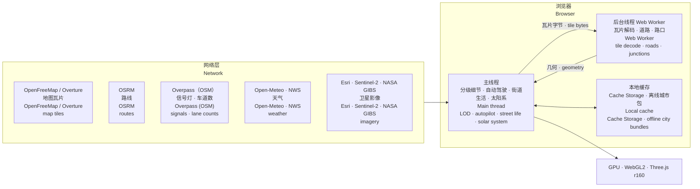

# 安全地球 · Sentinel Earth（中英对照 · Chinese–English）

[中文](README.zh.md) · [English](README.en.md) · **中英对照** · [한국어](README.ko.md) · [Deutsch](README.de.md) · [日本語](README.ja.md) · [Русский](README.ru.md) · [Español](README.es.md) · [总览 / Overview](README.md)

CSE635 软件安全工程课程项目：一个可以直接部署的三维地球网站。从整个太阳系一路放大到地球、城市、街道和单栋建筑，每一层都能看到对应的安全架构知识。

A CSE635 Software Security Engineering project: a deployable 3D globe website. Zoom from the whole solar system down to Earth, a city, its streets and a single building; every level shows the matching security-architecture knowledge.

---

## 一、一张图看懂缩放层级 · Zoom levels at a glance


## 二、快速开始 · Quick start

| 方式<br>How | 操作<br>Steps |
|---|---|
| Windows 本地<br>Windows, local | 双击 `start-sentinel-earth.bat`，浏览器会自动打开 http://localhost:8000<br>Double-click `start-sentinel-earth.bat`; the browser opens http://localhost:8000 |
| 任意系统本地<br>Any OS, local | 在项目文件夹运行 `python srv.py 8000`，再打开 http://localhost:8000<br>Run `python srv.py 8000` in the project folder, then open http://localhost:8000 |
| 部署上线<br>Deploy | 这个文件夹就是网站本身，没有构建步骤。可以在 Vercel 导入这个 GitHub 仓库，或把文件夹拖到 app.netlify.com/drop<br>The folder is the site itself; there is no build step. Import this GitHub repository in Vercel, or drag the folder onto app.netlify.com/drop |

> 本地服务器 `srv.py` 会关掉浏览器缓存，更新代码后刷新就能看到新版本。<br>The local server `srv.py` turns off browser caching, so a refresh always shows the latest code.

### 在自己的电脑上运行（详细步骤） · Run it on your own computer (step by step)

**第 1 步 · 准备环境**

**Step 1 · Prepare**
- 浏览器：新版 Chrome、Edge、Firefox 或 Safari，需要支持 WebGL2，并打开「硬件加速」。<br>Browser: a recent Chrome, Edge, Firefox or Safari with WebGL2 support and hardware acceleration turned on.
- Python 3.8 或更高版本：Windows 从 python.org 下载安装，安装时勾选「Add python.exe to PATH」；macOS 和 Linux 一般自带 `python3`。<br>Python 3.8 or later: on Windows, install it from python.org and tick "Add python.exe to PATH"; macOS and Linux usually ship `python3`.
- 磁盘空间约 1 GB（项目本身约 420 MB，含离线城市包）。有独立显卡会更流畅。<br>About 1 GB of disk space (the project itself is about 420 MB including the offline city bundles). A dedicated graphics card makes it smoother.

**第 2 步 · 下载代码**（任选一种）

**Step 2 · Get the code** (either way)
- 网页下载：打开 https://github.com/tianmingliu-pixel/sentinel-earth ，点绿色的「Code」→「Download ZIP」，解压到任意文件夹。<br>Download in the browser: open https://github.com/tianmingliu-pixel/sentinel-earth , click the green "Code" button → "Download ZIP", and unzip it into any folder.
- 用 Git：`git clone --depth 1 https://github.com/tianmingliu-pixel/sentinel-earth.git`<br>With Git: `git clone --depth 1 https://github.com/tianmingliu-pixel/sentinel-earth.git`

**第 3 步 · 启动**

**Step 3 · Start**
- Windows：进入解压后的文件夹，双击 `start-sentinel-earth.bat`。会弹出一个黑色窗口，并自动打开浏览器。<br>Windows: open the unzipped folder and double-click `start-sentinel-earth.bat`. A black window appears and the browser opens by itself.
- macOS / Linux：打开终端，运行 `cd sentinel-earth` 和 `python3 srv.py 8000`，再在浏览器打开 http://localhost:8000 。<br>macOS / Linux: in a terminal run `cd sentinel-earth` and `python3 srv.py 8000`, then open http://localhost:8000 in the browser.
- 使用期间不要关掉那个服务器窗口；关掉窗口或按 Ctrl+C 就会停止。<br>Keep that server window open while you use the site; closing it or pressing Ctrl+C stops the server.

**常见问题**

**Troubleshooting**

| 问题<br>Problem | 解决办法<br>Fix |
|---|---|
| 直接双击 `index.html` 打不开<br>Double-clicking `index.html` does not work | 浏览器禁止网页直接读取本地数据文件，必须按第 3 步用本地服务器打开<br>Browsers block pages from reading local data files directly; open it through the local server as in step 3 |
| 提示端口 8000 被占用<br>Port 8000 is already in use | 换一个端口，例如 `python srv.py 8080`，再打开 http://localhost:8080<br>Use another port, e.g. `python srv.py 8080`, then open http://localhost:8080 |
| 页面空白或很卡<br>Blank page or very slow | 在浏览器设置里打开硬件加速；在页面底部把「画质」调低<br>Turn on hardware acceleration in the browser settings; lower "Quality" at the bottom of the page |
| 别人连不上我的电脑<br>Others cannot reach my computer | `srv.py` 只允许本机访问；要分享给别人，请部署到 Vercel 或 Netlify<br>`srv.py` only accepts connections from this computer; to share the site, deploy it to Vercel or Netlify |
| 更新到最新版<br>Update to the latest version | 用 Git 的运行 `git pull`；下载 ZIP 的重新下载一次<br>With Git run `git pull`; with the ZIP, download it again |

> 网络说明：三维引擎已经放在项目的 `lib/` 文件夹里，断网也能打开网站，地球层和有离线城市包的城市都能正常浏览。实时街区、路线、天气和卫星影像需要联网。<br>Network: the 3D engine ships in the project's `lib/` folder, so the site opens without an internet connection; the globe and cities with an offline bundle work normally. Live streets, routes, weather and satellite imagery need the internet.

---

## 三、功能 · Features

### 1. 地球层 · Globe
- 拖动旋转，滚轮缩放。点任意国家，看它适用的安全级别（SL1 公开 → SL5 关键）和监管框架。<br>Drag to rotate, scroll to zoom. Click any country for its security level (SL1 Public → SL5 Critical) and regulatory frame.
- 时间线收录 238 起经过核实的安全事件（1971 年至今），可以按「安全大脑」分层筛选，也可以只看有机构通报的事件。<br>A timeline of 238 verified security events (1971 to today), filterable by source tier or by events an organisation reported.
- 「快速飞往」默认列出每个国家或地区的首都（225 个），按大洲分组；搜索框可以搜全部 2353 个地点。<br>"Fly to" lists one capital per country or region by default (225), grouped by continent; the search box covers all 2,353 places.
- 「覆盖」扫描：按城市中心的建筑密度评 A–D 级，报告可以导出 CSV 或 JSON。<br>Coverage scan grades each city A–D by building density at its centre; the report exports as CSV or JSON.

### 2. 太阳系 · Solar system
- 地球层打开「太阳系」开关：太阳在真实方向上，地球的昼夜分界线和此刻一致；月球在真实距离和月相上；水星到海王星出现在它们此刻在天空中的真实方向。<br>Turn on "Solar system" on the globe: the Sun sits in its true direction, so Earth's day/night line matches this moment; the Moon is at its true distance and phase; Mercury to Neptune appear in their true directions in the sky.
- 一直缩小，先看到地月系统，再进入「太阳系视角」：八大行星按今天的位置排在各自轨道上。点任意行星，看半径、离太阳和离地球的距离、光行时间、公转和自转周期。<br>Keep zooming out to see the Earth–Moon system, then the solar-system view with all eight planets at today's positions on their orbits. Click a planet for its radius, distance from the Sun and from Earth, light time, and orbital and rotation periods.
- 底部时间条：实时、暂停、1 天/秒、1 周/秒、1 月/秒、1 年/秒。<br>Time bar at the bottom: live, pause, 1 day/s, 1 week/s, 1 month/s, 1 year/s.
- 位置用 Schlyter 低精度星历计算，误差约 1–2 角分。太阳系视角里的距离和大小经过压缩，不是真实比例。<br>Positions come from Schlyter's low-precision ephemeris (about 1–2′). Distances and sizes in the solar-system view are compressed, not to scale.

### 3. 街道层 · Street level
- 实时载入 OpenStreetMap 街区，边走边加载；楼房少的街区用 Overture Maps 建筑数据补全。<br>Live OpenStreetMap streets that stream in as you move; blocks with few buildings are filled from Overture Maps.
- 建筑按规划类型着色（住宅、商业、政府、医院、教育等），点一栋楼看它从用户到后端的端到端安全链路。<br>Buildings are coloured by planning type (residential, commercial, government, hospital, education…). Click one for its end-to-end security chain from user to back end.
- 真实的太阳、月亮、云、雾、雨、雪、雷暴，四季行道树，夜晚路灯和亮窗。<br>Real sun, moon, clouds, fog, rain, snow and storms, seasonal street trees, street lamps and lit windows at night.
- 天眼视角：卫星影像、MGRS/UTM 坐标、多种传感器模式、附近安全事件、过境卫星、地震和自然灾害。<br>Sky eye: satellite imagery, MGRS/UTM coordinates, several sensor modes, nearby events, passing satellites, earthquakes and natural hazards.

### 4. 自动驾驶与交通规则 · Autopilot and traffic rules



- 设目的地后按 OSRM 真实路线行驶（不是瞬移），可选驾驶舱、追尾、无人机伴飞三种视角。<br>Set a destination and the car follows a real OSRM route (no teleporting). Cockpit, chase and drone-escort cameras.
- 车道数来自 OpenStreetMap 的 `lanes` 标签，查不到时按道路等级给默认值，区分单行道和双行道。车只在车道中间行驶，不压线。<br>Lane counts come from the OpenStreetMap `lanes` tag, with class defaults where it is missing; one-way and two-way roads are handled separately. Cars stay centred in a lane.
- 左转前并到靠中线的车道，在停止线前等灯；右转用最外侧车道；到达终点靠边停车。<br>Before a left turn the car moves to the lane by the centre line and waits at the stop line; right turns use the outside lane; at the destination it pulls over to the kerb.
- 周围的车辆、行人、狗和猫按同一套规则运行。行人只走人行道和斑马线。<br>Ambient cars, pedestrians, dogs and cats follow the same rules. Pedestrians walk only on pavements and crossings.
- 只保留 OpenStreetMap 里真实标注的 STOP 牌，不再到处放。<br>Only STOP signs actually mapped in OpenStreetMap are kept.

### 5. 语言：中文 / EN / 双语 · Language: 中文 / EN / 双语
- 右上角三个按钮切换，双语模式中英并排，例如「限速 / LIMIT」。选择会记在浏览器里。<br>Three buttons at the top right; bilingual mode shows both side by side, e.g. "限速 / LIMIT". The choice is remembered in the browser.
- 所有界面文字集中在语言包 `i18n.js`，详见第五节。<br>All interface text lives in the language pack `i18n.js` (see section 5).

---

## 四、整体架构 · Architecture



- 所有计算都在浏览器里完成，没有自己的后端或数据库。<br>Everything is computed in the browser; there is no back end or database of its own.
- 网络只用来取数据（瓦片、路线、天气、影像），取过的会存在浏览器缓存里。<br>The network is only used to fetch data (tiles, routes, weather, imagery), and fetched data is cached in the browser.
- 后台线程负责解码地图瓦片和生成道路几何，主线程负责交互和模拟，GPU 只负责画。<br>The worker decodes tiles and builds road geometry, the main thread handles interaction and simulation, and the GPU only draws.

---

## 五、文件结构 · Files

```
sentinel-earth/
├─ index.html              页面结构与样式 / page structure and styles
├─ app.js                  全部应用逻辑（地球、街道、驾驶、街道生活、太阳系……） / all application logic (globe, streets, driving, street life, solar system…)
├─ i18n.js                 语言包：中文 / English / 双语 / language pack: Chinese / English / bilingual
├─ data.js                 安全级别、建筑类型、监管框架等教学数据 / teaching data: security levels, building types, regulations
├─ data/
│  ├─ cities.json          2353 个地点（含 225 个首都） / 2,353 places (225 capitals)
│  ├─ events.json          238 起安全事件 / 238 security events
│  ├─ nodes.json           地球上的网络节点 / network nodes on the globe
│  ├─ earth/               地球贴图与国界矢量 / Earth textures and country vectors
│  ├─ streets/             各城市街道核心区 / street cores of each city
│  └─ bundles/             离线城市包（144 个文件，约 416 MB） / offline city bundles (144 files, about 416 MB)
├─ lib/three.min.js       三维引擎 Three.js r160（本地副本） / 3D engine Three.js r160 (local copy)
├─ LICENSE                 MIT 许可证与第三方数据说明 / MIT License and third-party data notes
├─ srv.py                  本地服务器（关闭缓存） / local server (no cache)
├─ start-sentinel-earth.bat  Windows 一键启动 / one-click start on Windows
├─ vercel.json             部署配置 / deployment config
└─ README*.md              说明文档 / documentation
```

### 语言包 `i18n.js` 怎么用 · Using the language pack `i18n.js`

| 部分<br>Part | 内容<br>Contents |
|---|---|
| `ui` | 界面标签：标题、面板、图例<br>interface labels: title, panels, legends |
| `s` | 其余所有屏幕文字（474 条）：抬头显示、面板、提示、驾驶、天眼、街道生活、太阳系<br>every other on-screen string (474): HUDs, panels, toasts, driving, sky eye, street life, solar system |
| `pick()` | 三种模式共用的取词规则<br>the one rule all three modes use |

每一条都是「键 → [中文, English]」。新增文字时：

Each entry is key → [Chinese, English]. To add a string:
1. 在 `i18n.js` 的 `s` 里加一行，比如 `my_label:['我的标签','My label'],`<br>Add a line to `s` in `i18n.js`, e.g. `my_label:['我的标签','My label'],`
2. 在 `app.js` 里用 `I18T('my_label')` 显示它。<br>Show it in `app.js` with `I18T('my_label')`.
3. 三种语言模式会自动生效。<br>All three language modes pick it up automatically.

---

## 六、数据来源 · Data sources

© OpenStreetMap 贡献者 · OpenMapTiles · OpenFreeMap（街道矢量瓦片）· Overture Maps Foundation（建筑补全）· OSRM（路线）· Overpass API（信号灯、车道数）· NASA GIBS / EONET · USGS · CelesTrak · RainViewer · Esri Wayback · Open-Meteo（天气，CC BY 4.0）· NASA（地球影像）· Schlyter 行星位置算法（太阳系）。

© OpenStreetMap contributors · OpenMapTiles · OpenFreeMap (street tiles) · Overture Maps Foundation (building fill) · OSRM (routes) · Overpass API (signals, lane counts) · NASA GIBS / EONET · USGS · CelesTrak · RainViewer · Esri Wayback · Open-Meteo (weather, CC BY 4.0) · NASA (Earth imagery) · Schlyter's planetary-position method (solar system).

## 七、说明 · Notes

- 环境安全态势、建筑网络链路都是教学参考，不评估任何具体建筑或机构。<br>The environmental security posture and building network chains are teaching references, not assessments of any specific building or organisation.
- 首都归属有争议的地方（如以色列、巴勒斯坦），列表里标的是政府机构实际所在的城市。<br>Where a capital is disputed (for example Israel, Palestine), the list shows the city where the government institutions actually sit.
- 许可证：代码采用 MIT 许可证（见 `LICENSE`）。来自 OpenStreetMap 的街道和地点数据遵循 ODbL 1.0，转用时要保留署名。<br>License: the code is under the MIT License (see `LICENSE`). Street and place data from OpenStreetMap is under ODbL 1.0; keep the attribution when reusing it.
