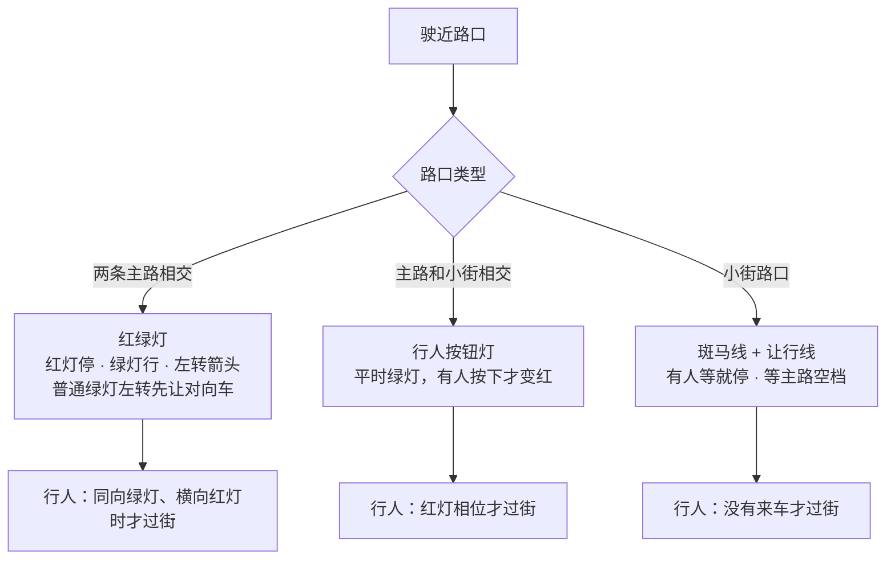
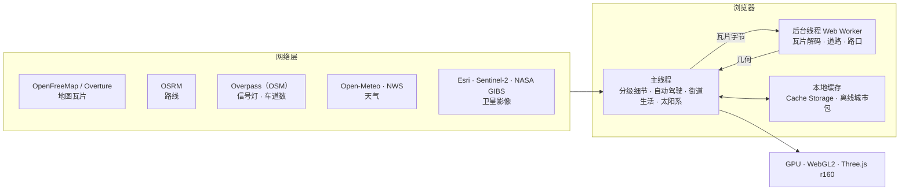

# 安全地球 · Sentinel Earth（中文说明）

**中文** · [English](README.en.md) · [中英对照](README.zh-en.md) · [한국어](README.ko.md) · [Deutsch](README.de.md) · [日本語](README.ja.md) · [Русский](README.ru.md) · [Español](README.es.md) · [总览](README.md)

CSE635 软件安全工程课程项目：一个可以直接部署的三维地球网站。从整个太阳系一路放大到地球、城市、街道和单栋建筑，每一层都能看到对应的安全架构知识。

---

## 一、一张图看懂缩放层级


## 二、快速开始

| 方式 | 操作 |
|---|---|
| Windows 本地 | 双击 `start-sentinel-earth.bat`，浏览器会自动打开 http://localhost:8000 |
| 任意系统本地 | 在项目文件夹运行 `python srv.py 8000`，再打开 http://localhost:8000 |
| 部署上线 | 这个文件夹就是网站本身，没有构建步骤。可以在 Vercel 导入这个 GitHub 仓库，或把文件夹拖到 app.netlify.com/drop |

> 本地服务器 `srv.py` 会关掉浏览器缓存，更新代码后刷新就能看到新版本。

### 在自己的电脑上运行（详细步骤）

**第 1 步 · 准备环境**
- 浏览器：新版 Chrome、Edge、Firefox 或 Safari，需要支持 WebGL2，并打开「硬件加速」。
- Python 3.8 或更高版本：Windows 从 python.org 下载安装，安装时勾选「Add python.exe to PATH」；macOS 和 Linux 一般自带 `python3`。
- 磁盘空间约 1 GB（项目本身约 420 MB，含离线城市包）。有独立显卡会更流畅。

**第 2 步 · 下载代码**（任选一种）
- 网页下载：打开 https://github.com/tianmingliu-pixel/sentinel-earth ，点绿色的「Code」→「Download ZIP」，解压到任意文件夹。
- 用 Git：`git clone --depth 1 https://github.com/tianmingliu-pixel/sentinel-earth.git`

**第 3 步 · 启动**
- Windows：进入解压后的文件夹，双击 `start-sentinel-earth.bat`。会弹出一个黑色窗口，并自动打开浏览器。
- macOS / Linux：打开终端，运行 `cd sentinel-earth` 和 `python3 srv.py 8000`，再在浏览器打开 http://localhost:8000 。
- 使用期间不要关掉那个服务器窗口；关掉窗口或按 Ctrl+C 就会停止。

**常见问题**

| 问题 | 解决办法 |
|---|---|
| 直接双击 `index.html` 打不开 | 浏览器禁止网页直接读取本地数据文件，必须按第 3 步用本地服务器打开 |
| 提示端口 8000 被占用 | 换一个端口，例如 `python srv.py 8080`，再打开 http://localhost:8080 |
| 页面空白或很卡 | 在浏览器设置里打开硬件加速；在页面底部把「画质」调低 |
| 别人连不上我的电脑 | `srv.py` 只允许本机访问；要分享给别人，请部署到 Vercel 或 Netlify |
| 更新到最新版 | 用 Git 的运行 `git pull`；下载 ZIP 的重新下载一次 |

> 网络说明：三维引擎 Three.js 从 CDN 加载，所以打开网站需要联网。实时街区、路线、天气和卫星影像也需要联网；连不上地图服务器时，有离线城市包的城市仍然可以浏览。

---

## 三、功能

### 1. 地球层
- 拖动旋转，滚轮缩放。点任意国家，看它适用的安全级别（SL1 公开 → SL5 关键）和监管框架。
- 时间线收录 238 起经过核实的安全事件（1971 年至今），可以按「安全大脑」分层筛选，也可以只看有机构通报的事件。
- 「快速飞往」默认列出每个国家或地区的首都（225 个），按大洲分组；搜索框可以搜全部 2353 个地点。
- 「覆盖」扫描：按城市中心的建筑密度评 A–D 级，报告可以导出 CSV 或 JSON。

### 2. 太阳系
- 地球层打开「太阳系」开关：太阳在真实方向上，地球的昼夜分界线和此刻一致；月球在真实距离和月相上；水星到海王星出现在它们此刻在天空中的真实方向。
- 一直缩小，先看到地月系统，再进入「太阳系视角」：八大行星按今天的位置排在各自轨道上。点任意行星，看半径、离太阳和离地球的距离、光行时间、公转和自转周期。
- 底部时间条：实时、暂停、1 天/秒、1 周/秒、1 月/秒、1 年/秒。
- 位置用 Schlyter 低精度星历计算，误差约 1–2 角分。太阳系视角里的距离和大小经过压缩，不是真实比例。

### 3. 街道层
- 实时载入 OpenStreetMap 街区，边走边加载；楼房少的街区用 Overture Maps 建筑数据补全。
- 建筑按规划类型着色（住宅、商业、政府、医院、教育等），点一栋楼看它从用户到后端的端到端安全链路。
- 真实的太阳、月亮、云、雾、雨、雪、雷暴，四季行道树，夜晚路灯和亮窗。
- 天眼视角：卫星影像、MGRS/UTM 坐标、多种传感器模式、附近安全事件、过境卫星、地震和自然灾害。

### 4. 自动驾驶与交通规则



- 设目的地后按 OSRM 真实路线行驶（不是瞬移），可选驾驶舱、追尾、无人机伴飞三种视角。
- 车道数来自 OpenStreetMap 的 `lanes` 标签，查不到时按道路等级给默认值，区分单行道和双行道。车只在车道中间行驶，不压线。
- 左转前并到靠中线的车道，在停止线前等灯；右转用最外侧车道；到达终点靠边停车。
- 周围的车辆、行人、狗和猫按同一套规则运行。行人只走人行道和斑马线。
- 只保留 OpenStreetMap 里真实标注的 STOP 牌，不再到处放。

### 5. 语言：中文 / EN / 双语
- 右上角三个按钮切换，双语模式中英并排，例如「限速 / LIMIT」。选择会记在浏览器里。
- 所有界面文字集中在语言包 `i18n.js`，详见第五节。

---

## 四、整体架构



- 所有计算都在浏览器里完成，没有自己的后端或数据库。
- 网络只用来取数据（瓦片、路线、天气、影像），取过的会存在浏览器缓存里。
- 后台线程负责解码地图瓦片和生成道路几何，主线程负责交互和模拟，GPU 只负责画。

---

## 五、文件结构

```
sentinel-earth/
├─ index.html              页面结构与样式
├─ app.js                  全部应用逻辑（地球、街道、驾驶、街道生活、太阳系……）
├─ i18n.js                 语言包：中文 / English / 双语
├─ data.js                 安全级别、建筑类型、监管框架等教学数据
├─ data/
│  ├─ cities.json          2353 个地点（含 225 个首都）
│  ├─ events.json          238 起安全事件
│  ├─ nodes.json           地球上的网络节点
│  ├─ earth/               地球贴图与国界矢量
│  ├─ streets/             各城市街道核心区
│  └─ bundles/             离线城市包（144 个文件，约 416 MB）
├─ srv.py                  本地服务器（关闭缓存）
├─ start-sentinel-earth.bat  Windows 一键启动
├─ vercel.json             部署配置
└─ README*.md              说明文档
```

### 语言包 `i18n.js` 怎么用

| 部分 | 内容 |
|---|---|
| `ui` | 界面标签：标题、面板、图例 |
| `s` | 其余所有屏幕文字（474 条）：抬头显示、面板、提示、驾驶、天眼、街道生活、太阳系 |
| `pick()` | 三种模式共用的取词规则 |

每一条都是「键 → [中文, English]」。新增文字时：
1. 在 `i18n.js` 的 `s` 里加一行，比如 `my_label:['我的标签','My label'],`
2. 在 `app.js` 里用 `I18T('my_label')` 显示它。
3. 三种语言模式会自动生效。

---

## 六、数据来源

© OpenStreetMap 贡献者 · OpenMapTiles · OpenFreeMap（街道矢量瓦片）· Overture Maps Foundation（建筑补全）· OSRM（路线）· Overpass API（信号灯、车道数）· NASA GIBS / EONET · USGS · CelesTrak · RainViewer · Esri Wayback · Open-Meteo（天气，CC BY 4.0）· NASA（地球影像）· Schlyter 行星位置算法（太阳系）。

## 七、说明

- 环境安全态势、建筑网络链路都是教学参考，不评估任何具体建筑或机构。
- 首都归属有争议的地方（如以色列、巴勒斯坦），列表里标的是政府机构实际所在的城市。
